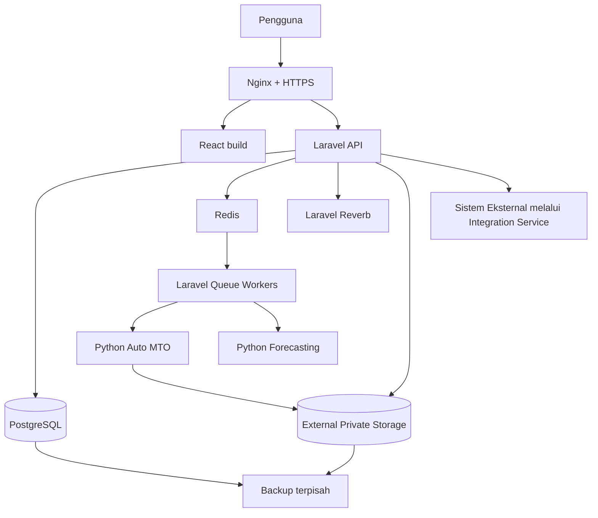

# 02 — System Architecture

## 1. Keputusan arsitektur yang disetujui

DISTRIVA menggunakan **modular monolith** pada backend Laravel, dengan frontend terpisah dan dua service Python khusus. Arsitektur ini dipilih agar domain bisnis tetap terstruktur tanpa menambah kompleksitas microservices terlalu dini.

| Layer | Teknologi | Tanggung jawab |
|---|---|---|
| Frontend | React + Vite + Tailwind CSS | UI dan interaksi pengguna |
| API/backend | Laravel API | Business logic, workflow, validasi, integrasi |
| Authentication | Laravel Sanctum | Autentikasi API/session sesuai deployment |
| Authorization | Spatie Permission + organizational scope | Role, permission, pembatasan UP3/ULP |
| Database | PostgreSQL | Sumber kebenaran transaksi internal |
| Cache/queue | Redis + Laravel Queue | Cache dan pekerjaan asynchronous |
| Realtime | Laravel Reverb | Notifikasi realtime |
| Auto MTO | Python service | OCR, parsing Excel/CAD, analisis gambar dan ekstraksi kandidat material |
| Forecasting | Python service | Forecast volume pekerjaan dan konversi kebutuhan melalui BOM |
| Charts | Recharts | Grafik dashboard dan analisis |
| File storage | Private external storage | File asli, revisi, hasil ekstraksi, PDF dan arsip |

## 2. Prinsip arsitektur

1. PostgreSQL adalah satu-satunya sumber kebenaran data transaksi internal DISTRIVA.
2. Redis hanya untuk cache, queue, dan koordinasi proses; bukan database transaksi.
3. Python Auto MTO dan Forecasting tidak mengakses PostgreSQL produksi secara langsung. Komunikasi dilakukan melalui API/service boundary Laravel.
4. Laravel Integration Service menjadi pintu komunikasi ke sistem eksternal.
5. File dokumen tidak disimpan pada public web root dan tidak dapat diakses langsung tanpa otorisasi Laravel.
6. Role tidak cukup untuk membatasi data; semua query dan policy harus memeriksa organizational scope.
7. Perhitungan dan dokumen yang telah disetujui harus dapat ditelusuri ke versi input, master, parameter, dan template.
8. Proses berat berjalan asynchronous melalui Redis Queue; kegagalan proses tidak boleh menghilangkan transaksi utama.

## 3. Deployment yang dipilih — T4.1.2

Keputusan pengguna:
- Satu server Ubuntu yang sudah tersedia untuk seluruh komponen aplikasi.
- Storage dokumen dipisahkan dari server aplikasi.
- Tidak diwajibkan membeli tiga server produksi pada tahap awal.

Komponen pada server Ubuntu:
- Nginx sebagai reverse proxy dan web server.
- React production build (Vite `dist`).
- Laravel API dengan PHP-FPM.
- PostgreSQL.
- Redis.
- Laravel Queue Worker.
- Laravel Reverb.
- Python Auto MTO service.
- Python Forecasting service.
- Supervisor dan/atau systemd untuk menjaga proses.
- Laravel Scheduler/cron.

Dokumen berada pada NAS atau storage server terpisah melalui jaringan privat. NFS adalah opsi rancangan yang direkomendasikan, tetapi protokol final menunggu pemeriksaan perangkat dan jaringan yang tersedia.



## 4. Alur Auto MTO

1. Petugas ULP mengunggah satu file gambar utama (bila memungkinkan) dan file pendukung opsional sebagai satu package/version.
2. Laravel menyimpan metadata dan file pada private storage.
3. Laravel membuat job pada Redis Queue.
4. Python mengambil file melalui mekanisme API terotorisasi.
5. Python melakukan parsing sesuai format: XLS/XLSX, PDF, DWG/DXF, JPG/PNG.
6. Python mengirim hasil ekstraksi, confidence/temuan, referensi halaman/koordinat/objek ke Laravel.
7. Laravel menyimpan hasil sebagai draft MTO; petugas teknis ULP wajib memverifikasi.
8. Hasil terverifikasi dilanjutkan ke persetujuan Manager ULP dan review paralel UP3.

AI/OCR/CV hanya menghasilkan kandidat ekstraksi. Penetapan kebutuhan material final tetap melalui verifikasi teknis manusia. KHS code adalah kunci utama pencocokan; kode yang tidak ditemukan tidak boleh ditebak dari kemiripan nama.

## 5. Alur Forecasting

Laravel menyiapkan dataset dan snapshot yang diperlukan, lalu mengirim pekerjaan ke Python Forecasting melalui API. Python mengembalikan hasil run, metrik evaluasi, versi model, rentang data, horizon, dan hasil prediksi. Laravel menyimpan hasil tersebut. Forecast pekerjaan dikonversi ke kebutuhan material melalui BOM yang berlaku.

Histori permohonan tidak sama dengan histori konsumsi material aktual. Model awal memprediksi volume/jenis pekerjaan, bukan konsumsi aktual material.

## 6. Integrasi eksternal

Seluruh koneksi eksternal melalui Integration Service Laravel dengan adapter API, webhook, file, atau akses database resmi yang disetujui. Sistem eksternal yang direncanakan meliputi Bot Daftung, EIS AP2T, payment system, ERP master material, aplikasi material, email gateway, dan WhatsApp gateway. Endpoint, autentikasi, payload, serta SLA integrasi belum boleh diasumsikan sebelum kontrak teknis tersedia.

Aplikasi material yang sudah ada tetap menjadi sumber kebenaran master material operasional, gudang, stok, alokasi, issue, transfer, retur, dan stock opname. DISTRIVA mengirim kebutuhan WO yang telah disetujui dan menerima status/snapshot yang relevan.

## 7. Infrastruktur dan kapasitas

Target awal untuk perencanaan satu server:
- Ubuntu Server 24.04 LTS.
- Target nyaman: 8 core/16 thread, RAM 32 GB, NVMe 500 GB untuk OS/aplikasi/database.
- Target ini bukan prasyarat final; kapasitas aktual harus diperiksa dengan `lscpu`, `free -h`, `df -h`, `lsblk`, dan monitoring beban.
- Batasi concurrency OCR/CAD agar tidak mengganggu API dan PostgreSQL.
- GPU tidak diwajibkan pada tahap pertama; evaluasi kembali bila model computer vision berat digunakan.

Storage eksternal: titik awal perencanaan 2 TB untuk dokumen; backup terpisah disarankan 4 TB atau sesuai hasil perhitungan retensi dan pertumbuhan. Angka tersebut estimasi, bukan sizing final.

## 8. Keamanan, backup, dan observability

- HTTPS untuk akses aplikasi.
- PostgreSQL, Redis, dan Python internal tidak dibuka langsung ke internet.
- SSH menggunakan key-based authentication dan firewall membatasi port.
- File privat diakses melalui Laravel Policy dan organizational scope.
- Credential integrasi dienkripsi.
- Log service dipisahkan; monitoring CPU, RAM, disk, PostgreSQL, Redis, queue, Reverb, integrasi, dan storage.
- Backup PostgreSQL dan dokumen berada pada lokasi terpisah; WAL archiving diperlukan untuk target RPO 1 jam.
- Target pemulihan yang disepakati: RPO 1 jam, RTO 4 jam; wajib dibuktikan melalui restore drill.

## 9. Struktur repository target

```text
DISTRIVA/
├── backend/                 # Laravel API modular
├── frontend/                # React + Vite + Tailwind
├── services/
│   ├── auto-mto/            # Python OCR/CAD/vision/extraction
│   └── forecasting/         # Python forecasting
├── deployment/
│   ├── nginx/
│   ├── supervisor/
│   └── scripts/
└── documentation/
```

Struktur direktori server produksi dan struktur repository Git dapat berbeda. `.env`, credential, private key, dan file rahasia tidak boleh masuk Git.

## 10. Status keputusan

| Item | Status |
|---|---|
| Modular monolith Laravel | Disetujui |
| React + Vite + Tailwind | Disetujui |
| PostgreSQL sebagai source of truth | Disetujui |
| Python Auto MTO dan Forecasting melalui API | Disetujui |
| Redis Queue dan Reverb | Disetujui |
| Satu server Ubuntu tersedia untuk seluruh komponen | Disetujui |
| External private document storage | Disetujui |
| NFS sebagai protokol storage | Rekomendasi, belum final |
| Kapasitas hardware aktual | Menunggu pemeriksaan server |
| Domain, IP, firewall, dan topologi jaringan | T4.1.3 |


## Update v3.2 — Document Service dan Auto MTO
Dokumen disimpan pada private storage DISTRIVA dan dilayani melalui Laravel policy. Python Auto MTO tidak mengakses database atau filesystem produksi secara langsung; Laravel menerbitkan akses sementara bertoken ke file versi tertentu. Pemrosesan berjalan per file dalam satu paket, sehingga kegagalan satu file tidak menghentikan file lain. Rincian tabel dan alur ada di dokumen 26 dan DDL baseline 27.
