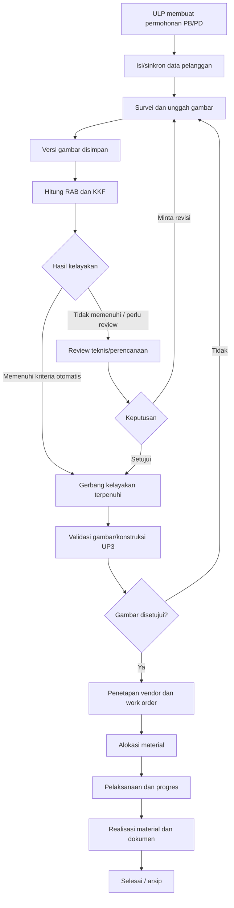
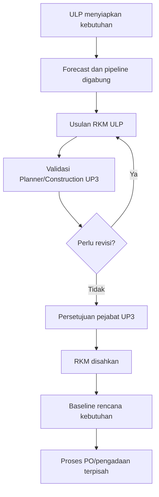

# 04 — Business Workflow

## 1. Alur utama PB/PD

## 2. Catatan workflow

- PB/PD dapat menggunakan data pelanggan manual atau hasil sinkronisasi Bot Daftung.
- Status permohonan tidak boleh dicampur dengan status RKM atau PO.
- Satu permohonan dapat mempunyai banyak versi gambar.
- Satu versi gambar dapat dihitung beberapa kali.
- Revisi gambar tidak menghapus versi sebelumnya.
- Hasil kelayakan otomatis adalah gerbang proses, bukan pengganti persetujuan yang diwajibkan kebijakan.
- Peran yang berwenang memutuskan tiap tahapan harus ditetapkan dalam konfigurasi workflow.

## 3. Alur RKM terpisah

## 4. Status yang disarankan

### Permohonan
`DRAFT`, `SUBMITTED`, `SURVEY_REQUIRED`, `CALCULATED`, `FEASIBILITY_REVIEW`, `REVISION_REQUIRED`, `TECHNICAL_REVIEW`, `APPROVED`, `REJECTED`, `WORK_ASSIGNED`, `IN_PROGRESS`, `COMPLETED`, `CANCELLED`.

Status final harus diselaraskan dengan istilah resmi operasional.

### Gambar
`DRAFT`, `SUBMITTED`, `REVISION_REQUIRED`, `APPROVED`, `SUPERSEDED`.

### Work order
`DRAFT`, `ISSUED`, `IN_PROGRESS`, `ON_HOLD`, `COMPLETED`, `CANCELLED`.

Role pembuat, pemeriksa, dan penerbit WO belum ditetapkan. Vendor-assignment approval oleh ASMAN_KONSTRUKSI tidak otomatis menjadi approval/penerbitan WO. Sebelum issue, WO harus merujuk vendor assignment yang disetujui dan versi drawing/BOM/RAB yang approved; urutan approval WO dan verifikasi final masih open.

### RKM
`DRAFT`, `SUBMITTED`, `UNDER_VALIDATION`, `REVISION_REQUIRED`, `APPROVED`, `REJECTED`, `CLOSED`.

### Procurement
Status procurement dikelola terpisah dan belum didefinisikan rinci dalam blueprint ini.

## 5. Pencegahan double counting

- Permohonan yang sudah tercatat sebagai aktual tidak boleh ditambahkan lagi sebagai forecast permohonan baru.
- Pipeline aktif harus dipisahkan dari actual approved demand.
- Forecast permohonan baru hanya memproyeksikan permohonan masa depan yang belum tercatat.
- Setiap demand record harus memiliki kategori sumber: `approved`, `pipeline`, atau `forecast`.
- Aturan bobot pipeline hanya digunakan jika probabilitas konversi didukung data historis; jika belum, gunakan skenario yang disepakati pengguna.

### Catatan kewenangan T4.2.1.2A (v3.7.0)

- RKM: ULP mengusulkan; `PERENCANAAN` dan `KONSTRUKSI_UP3` wajib memvalidasi oleh user berbeda; `UP3_MANAGER` menjadi final approver. Submitter tidak boleh final-approve versinya sendiri; RKM tetap bukan procurement. Role konkret pengusul ULP masih perlu diputuskan.
- Pengawas jaringan tidak menjadi role baru. Setiap pemegang assignment efektif `KONSTRUKSI_UP3` pada UP3 terkait dapat melakukan verifikasi progres dan inspeksi seluruh WO child-ULP tanpa assignment tambahan per WO/task; kewenangan tetap khusus dan terbatas. Ini bukan `UP3_DESCENDANT_READ` dan belum diimplementasikan.
- Semua approval/review AND mensyaratkan user berbeda; submitter tidak final-approve versi sendiri. Submitter progres (vendor maupun internal) wajib berbeda dari verifier.
- Report/dashboard mengikuti permission dan scope sumber; export memerlukan permission terpisah per domain. Aktor survey, status permohonan, dan pembuat/penerbit WO masih menunggu konfirmasi. Kandidat permission bukan permission final.

## Update v3.2 — Gate dokumen dan Auto MTO
Setiap dokumen logis memiliki versi immutable. Untuk gambar, submission ULP disetujui Manager ULP sebelum review paralel UP3 oleh Konstruksi dan Perencanaan. Auto MTO verification/approval oleh petugas teknis ULP dan Manager ULP adalah proses terpisah dari drawing review. Jika revisi mengubah quantity/spec, MTO dan RAB/KKF dihitung ulang; jika tidak, tetap direview tanpa recalc.
