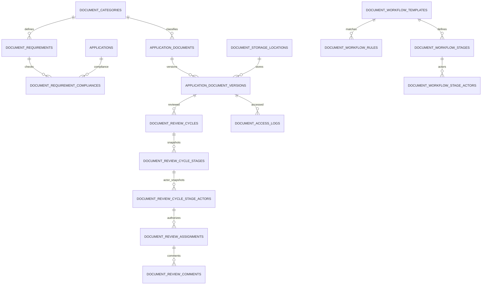
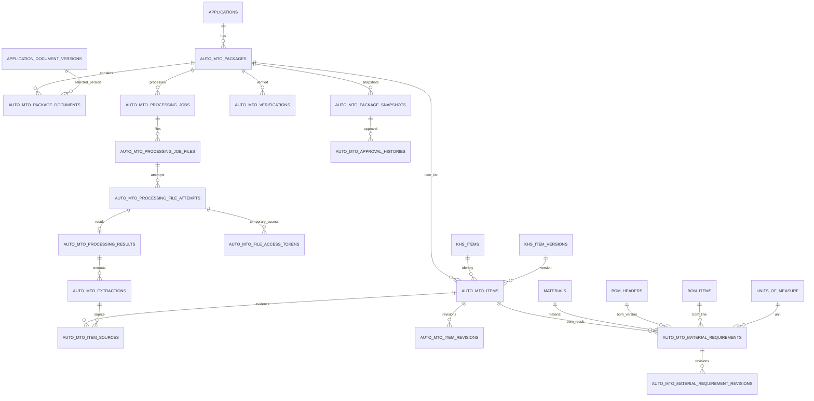

# 06 — ERD DISTRIVA (Gabungan T4.2.1–T4.2.4)

**Versi:** 3.4.0 | **Status:** ERD desain gabungan. T4.2.1 migration up/down telah diuji pada PostgreSQL disposable dan di-rollback; tidak ada tabel aplikasi tersisa. Domain T4.2.2–T4.2.4 tetap mengikuti status masing-masing di dokumen 17. Diagram domain berikut sengaja dipecah agar dapat dibaca dan tidak menyamarkan composite FK.

## 1. Foundation, organisasi, dan PB/PD

```mermaid
erDiagram
 USERS ||--o{ USER_ROLE_ASSIGNMENTS : assigned
 USERS o|--o{ USER_ROLE_ASSIGNMENTS : assigns
 ROLES ||--o{ USER_ROLE_ASSIGNMENTS : grants
 ORGANIZATIONAL_UNITS o|--o{ USER_ROLE_ASSIGNMENTS : scope
 ORGANIZATIONAL_UNITS ||--o{ ORGANIZATIONAL_UNITS : parent
 ORGANIZATIONAL_UNITS ||--o{ ORGANIZATIONAL_UNIT_HISTORIES : history
 USERS ||--o{ ORGANIZATIONAL_UNIT_HISTORIES : changes
 USER_ROLE_ASSIGNMENTS ||--o{ USER_ROLE_ASSIGNMENT_HISTORIES : history
 USERS o|--o{ USER_ROLE_ASSIGNMENT_HISTORIES : actor
 USER_ROLE_ASSIGNMENTS o|--o{ USER_ROLE_ASSIGNMENT_HISTORIES : actor_context
 USERS o|--o{ AUTHORIZATION_CHANGE_HISTORIES : account_subject
 USERS o|--o{ AUTHORIZATION_CHANGE_HISTORIES : actor
 ROLES o|--o{ AUTHORIZATION_CHANGE_HISTORIES : role_subject
 PERMISSIONS o|--o{ AUTHORIZATION_CHANGE_HISTORIES : permission_subject
 ROLES ||--o{ ROLE_HAS_PERMISSIONS : grants
 PERMISSIONS ||--o{ ROLE_HAS_PERMISSIONS : granted_permission
 CUSTOMERS ||--o{ APPLICATIONS : submits
 CUSTOMERS ||--o{ CUSTOMER_EXTERNAL_REFERENCES : identifiers
 ORGANIZATIONAL_UNITS ||--o{ APPLICATIONS : ULP
 APPLICATIONS ||--o{ APPLICATION_EXTERNAL_REFERENCES : references
 APPLICATIONS ||--o{ APPLICATION_EXTERNAL_STATUS_HISTORIES : external_status
 APPLICATIONS ||--o{ APPLICATION_SURVEYS : surveyed
 APPLICATIONS ||--o{ APPLICATION_DOCUMENTS : owns
```

## 2. Dokumen, versi, workflow review

## 3. Auto MTO

## 4. Integritas yang tidak terlihat penuh pada diagram

- `application_documents.current_version_id` menggunakan composite FK `(id,current_version_id)` → `(application_document_versions.document_id,id)`.
- `auto_mto_package_documents` memastikan application, package, document dan document version satu konteks.
- `auto_mto_processing_job_files` memastikan job-package serta package-document-version cocok.
- `auto_mto_file_access_tokens` mengikat attempt ke job-file yang sama.
- `auto_mto_material_requirements` memastikan item KHS/BOM/material/formula/unit sesuai; sebagian validasi lintas tabel memakai trigger.
- `auto_mto_verifications` memastikan tepat satu target dan target milik package yang sama.
- `auto_mto_approval_histories` composite FK ke snapshot dalam package yang sama.
- Actor rules disnapshot pada `document_review_cycle_stage_actors`; assignment harus merujuk snapshot itu.

## 5. Dependencies yang dipakai ulang

T4.2.4 tidak mendefinisikan ulang `users`, `roles`, `organizational_units`, `applications`, `materials`, `units_of_measure`, `khs_items`, `khs_item_versions`, `bom_headers`, `bom_items`, atau `bom_formula_definitions`. Sumber struktur dan keputusan: dokumen 22, 23, dan 24.

## T4.2.4 — relasi lineage tambahan v3.2.1

- `auto_mto_processing_results` → `auto_mto_processing_file_attempts` → `auto_mto_processing_job_files` → `auto_mto_packages` menentukan asal paket untuk setiap extraction. `auto_mto_extractions.package_id` divalidasi oleh trigger terhadap rantai tersebut.
- `auto_mto_item_sources` menghubungkan `auto_mto_items` dan `auto_mto_extractions` melalui composite FK `(package_id, target_id)`, sehingga sumber ekstraksi tidak dapat berasal dari paket lain.
- `document_review_cycle_stage_actors.source_stage_actor_id` harus berasal dari workflow stage yang disnapshot oleh cycle stage.
