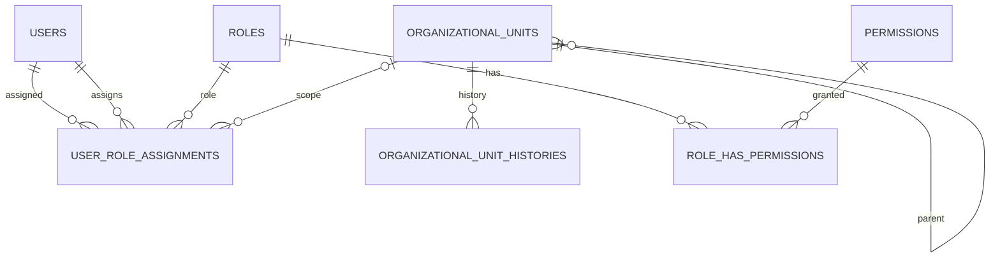

# 22 — T4.2.1 Foundation Schema (Approved Design and Implementation Baseline)

Tanggal review: 5 November 2026  
Status: desain bisnis dan integrasi Opsi A disetujui. Migration/model/seeder tersedia di `backend/`; PostgreSQL migration/seeder/integrity smoke test PASS pada disposable target, lalu semua migration di-rollback. Fondasi `ScopedAuthorizationService` telah dibuat dan unit-tested; policy, write paths, vendor domain resolver, dan end-to-end authorization masih pending. Lihat `33-T4.2.1.1-SCOPED-AUTHORIZATION.md`.

## 1. Keputusan arsitektur akses

Opsi A — Custom Scoped Assignment disetujui. `user_role_assignments` adalah sumber kebenaran tunggal penugasan role pengguna. Spatie Laravel Permission mengelola katalog role, permission, dan relasi role-permission. Spatie Teams tidak digunakan. `model_has_roles` tidak digunakan sebagai jalur assignment kedua.

## 2. Tabel dan kolom

### 2.1 organizational_units

| Kolom | Tipe | Null | Aturan |
|---|---|---:|---|
| id | UUID | No | PK |
| code | VARCHAR(30) | No | Unique business key resmi PLN |
| name | VARCHAR(150) | No | Nama unit |
| unit_type | VARCHAR(10) | No | `UP3` atau `ULP` |
| parent_id | UUID | Yes | Self FK; UP3 NULL, ULP parent UP3 |
| address | TEXT | Yes | Alamat |
| is_active | BOOLEAN | No | Default true |
| created_at / updated_at | TIMESTAMPTZ | Yes | Laravel timestamps |

FK parent menggunakan ON DELETE RESTRICT. Parent type validation membutuhkan trigger/service transaksional. Index: unique(code), index(parent_id), index(unit_type,is_active).

### 2.2 organizational_unit_histories

`id UUID PK`, `organizational_unit_id UUID FK`, nilai unit sebelum/sesudah untuk `code`, `name`, `unit_type`, `parent_id`, dan `is_active`, `reason TEXT`, `changed_by UUID FK users`, `changed_at TIMESTAMPTZ`. Catat perubahan penting organisasi. Histori tidak dapat diedit/dihapus melalui operasi aplikasi biasa.

### 2.3 users

`id UUID PK`, `nip VARCHAR(30) NULL UNIQUE`, `name VARCHAR(150)`, `email VARCHAR(150) UNIQUE`, `phone VARCHAR(30) NULL`, `password VARCHAR(255)`, `account_status VARCHAR(30)`, `must_change_password BOOLEAN`, `email_verified_at TIMESTAMPTZ NULL`, `last_login_at TIMESTAMPTZ NULL`, timestamps. Status: `PENDING_ACTIVATION`, `ACTIVE`, `SUSPENDED`, `INACTIVE`. NIP opsional; bila ada harus unik. Email dinormalisasi lowercase.

### 2.4 roles dan permissions (Spatie)

`roles`: BIGINT PK, name, guard_name, description (custom), requires_unit_scope BOOLEAN. `permissions`: BIGINT PK, name, guard_name. `role_has_permissions`: pivot BIGINT role_id dan permission_id. `requires_unit_scope=false` hanya untuk `SYS_ADMIN`; true untuk 13 role lainnya. Nama role final ada di `03-ROLES-AND-ACCESS.md`.

### 2.5 user_role_assignments

| Kolom | Tipe | Null | Aturan |
|---|---|---:|---|
| id | UUID | No | PK |
| user_id | UUID | No | FK users |
| role_id | BIGINT | No | FK roles |
| organizational_unit_id | UUID | Yes | FK organizational_units; NULL hanya SYS_ADMIN |
| valid_from | DATE | No | Awal masa berlaku, inklusif |
| valid_until | DATE | Yes | Akhir masa berlaku, inklusif |
| is_active | BOOLEAN | No | Default true |
| assigned_by | UUID | Yes | FK users |
| assignment_document | VARCHAR(255) | Yes | Referensi dokumen penugasan |
| created_at / updated_at | TIMESTAMPTZ | Yes | Laravel timestamps |

`CHECK(valid_until IS NULL OR valid_until >= valid_from)`. Assignment efektif hanya jika user ACTIVE, assignment aktif, tanggal sekarang dalam rentang, unit aktif (jika scoped), dan role/permission tersedia.

### 2.6 user_role_assignment_histories

Tabel append-only untuk merekam pembuatan, perubahan, perpanjangan, dan pencabutan assignment:

`id UUID PK`, `user_role_assignment_id UUID FK`, `event_type`, `before_values JSONB NULL`, `after_values JSONB NULL`, `reason TEXT`, `actor_user_id UUID NULL FK users`, `actor_assignment_id UUID NULL FK user_role_assignments`, `changed_at TIMESTAMPTZ`.

Actor assignment menyimpan konteks role/unit yang digunakan saat perubahan. Snapshot tidak boleh memuat password, token, OTP, atau secret. Aplikasi biasa tidak boleh mengubah/menghapus baris histori.

### 2.7 authorization_change_histories

Tabel append-only untuk audit perubahan status akun dan katalog authorization:

`id UUID PK`, `event_type VARCHAR(40)`, `user_id UUID NULL FK users`, `role_id BIGINT NULL FK roles`, `permission_id BIGINT NULL FK permissions`, `actor_user_id UUID NULL FK users`, `before_values JSONB NULL`, `after_values JSONB NULL`, `reason TEXT NULL`, `changed_at TIMESTAMPTZ`.

Event yang didukung: `USER_STATUS_CHANGED`, `ROLE_METADATA_CHANGED`, `PERMISSION_CATALOG_CHANGED`, `ROLE_PERMISSION_GRANTED`, dan `ROLE_PERMISSION_REVOKED`. CHECK membatasi kombinasi target sesuai jenis event: user saja, role saja, permission saja, atau role+permission. Perubahan data dan audit ditulis dalam satu transaksi. Jangan menyimpan secret di JSONB.

## 3. Integritas dan constraint

1. Unique `organizational_units.code`.
2. Unique email; normalisasi lowercase dan unique index pada `lower(email)` bila collation/penyimpanan tidak menjamin konsistensi.
3. NIP nullable unique; unique index parsial `WHERE nip IS NOT NULL` dapat digunakan.
4. FK menggunakan RESTRICT agar record historis tidak terhapus akibat cascade.
5. UP3 parent NULL; ULP wajib parent bertipe UP3. Gunakan trigger PostgreSQL dan validasi service.
6. Role dengan `requires_unit_scope=true` wajib `organizational_unit_id`; role false boleh NULL. Trigger/service menjaga konsistensi terhadap katalog role.
7. Assignment user-role-unit tidak boleh memiliki rentang tanggal overlap. Gunakan extension `btree_gist` dan exclusion constraint dengan `daterange(valid_from, COALESCE(valid_until,'infinity'::date),'[]')`; buat aturan terpisah untuk unit NULL (global). Uji pada PostgreSQL 18 sebelum migration final.
8. Assignment tidak dihapus untuk mencabut akses; ubah `is_active=false` atau set `valid_until` sesuai dokumen.
9. Tidak ada cascade delete pada unit/user/role yang sudah direferensikan.
10. Setiap perubahan assignment harus menambah baris histori sebelum/sesudah dalam transaksi yang sama; perubahan status akun dan role-permission dicatat pada `authorization_change_histories`; detail aktor tercatat dalam proposal review.

## 4. Index yang disarankan

- `organizational_units(parent_id)`
- `organizational_units(unit_type,is_active)`
- `users(account_status)`
- `user_role_assignments(user_id,is_active)`
- `user_role_assignments(organizational_unit_id,is_active)`
- `user_role_assignments(role_id,is_active)`
- `user_role_assignments(user_id,organizational_unit_id)`
- Index range GiST untuk exclusion constraint assignment.

## 5. Authorization flow

`ScopedAuthorizationService` mengambil assignment efektif, role, unit, serta permissions dari `role_has_permissions`. Laravel Policy memeriksa permission dan scope record; query list harus menerapkan scope sebelum pagination. Akun harus `ACTIVE`, assignment harus aktif dan berlaku pada tanggal bisnis Asia/Jakarta, serta unit harus aktif. Hierarki UP3→ULP hanya memperluas read/action sesuai permission dan matriks; tidak otomatis memberi approval. `SYS_ADMIN` global tidak otomatis dapat membaca dokumen bisnis. Vendor tetap memerlukan unit dan pembatasan tambahan melalui relasi vendor-company dan assigned WO/project.

Spatie dipakai hanya untuk role/permission catalog dan `role_has_permissions`: jangan gunakan `HasRoles`, `assignRole`/`syncRoles`, user pivots, Teams, atau default package permission resolver. Konfigurasikan `register_permission_check_method=false`; Policy memanggil service DISTRIVA. Invalidasi cache katalog Spatie dan cache scope DISTRIVA saat role-permission, assignment, user status, atau unit berubah. Audit setiap perubahan role, assignment, dan struktur unit.

## 6. Package compatibility

Baseline yang dipasang: Laravel Framework 13.40.0, Sanctum 4.3.3, dan Spatie Permission 8.3.2 pada PHP 8.5.4. Guard canonical `web`. Migration Spatie dikustomisasi agar hanya membuat `roles`, `permissions`, dan `role_has_permissions`, tanpa pivot user `model_has_roles`/`model_has_permissions`; Teams tidak digunakan. `User` tidak memakai trait `HasRoles`, dan `register_permission_check_method=false`. Migration Sanctum memakai UUID morph key. Unit test telah memverifikasi konfigurasi katalog dan model UUID; pembuatan/autentikasi token UUID end-to-end masih harus diuji pada PostgreSQL.

### 6.1 Implementasi ScopedAuthorizationService — v3.5.0

- Model `OrganizationalUnit` dan `UserRoleAssignment` memetakan tabel baseline; `User` dan `Role` memiliki relasi assignment. Tidak ada perubahan schema/migration.
- `ScopedAuthorizationService::effectiveAssignments()` membatasi user ACTIVE, assignment aktif/tanggal berlaku, role guard canonical, unit aktif untuk role scoped, dan SYS_ADMIN global tanpa unit.
- `allows()` memerlukan permission yang benar-benar terhubung melalui relasi Spatie `role_has_permissions`, lalu menerapkan konteks scope. Default adalah unit yang sama; ULP anak hanya melalui `UP3_DESCENDANT_READ` yang eksplisit.
- `SYSTEM` hanya berlaku untuk assignment SYS_ADMIN global tanpa target unit; tidak memberi akses bisnis otomatis.
- Vendor memerlukan identifier company, project, dan work order serta `VendorScopeAuthorizer`. Binding aktual adalah deny-all karena model/relasi domain vendor belum tersedia.
- Belum ada Policy/route yang menggunakan service, cache authorization, write path, permission key seeder, atau tes PostgreSQL untuk query Eloquent. Pengujian v3.5.0 adalah unit tests dengan assignment/model in-memory.

## 7. ERD ringkas

## 8. Implementasi dan batas validasi

Migration baseline tersedia untuk users, Sanctum tokens, katalog Spatie, organizational units dan histories, role assignments dan histories, authorization change histories, serta PostgreSQL checks/triggers/exclusion constraints. Migration integrity mewajibkan extension `btree_gist` yang diprovision terpisah. RoleSeeder memuat 14 role catalog dan mencatat perubahan metadata role; tidak ada permission keys, user, unit, atau assignment produksi yang di-seed.

Pada checkpoint v3.4.0, runtime PostgreSQL 18.6 disposable memverifikasi 11 migration up/down, RoleSeeder idempotency, ketiadaan user pivots, sembilan trigger, serta constraint/trigger smoke checks dengan SQLSTATE yang diharapkan. Semua tabel aplikasi telah di-rollback; `btree_gist` tetap terpasang sesuai persetujuan. Baseline saat itu lulus 5/5 tests (10 assertions); PHP syntax, Pint, `route:list`, dan Composer validation lulus. `pdo_sqlite` tidak tersedia pada environment saat itu sehingga pemeriksaan SQLite saat `artisan install:api` gagal; route API tetap terdaftar. Test v3.5.0 terkini dicatat terpisah di `test-evidence/2026-11-05-t4211-authorization.md`.

Belum termasuk: Laravel Policies, assignment/unit write services, audit write path untuk perubahan status/assignment/role-permission/unit, cache invalidation DISTRIVA, permission keys final T4.4, dan vendor-company/project/WO resolver domain. Query Eloquent `effectiveAssignments()` belum diuji melalui PostgreSQL; concurrency stress, Sanctum UUID end-to-end, dan behavior pada production deployment/privileges tetap harus diuji. Rincian implementasi service dan unit test ada di `33-T4.2.1.1-SCOPED-AUTHORIZATION.md`.
