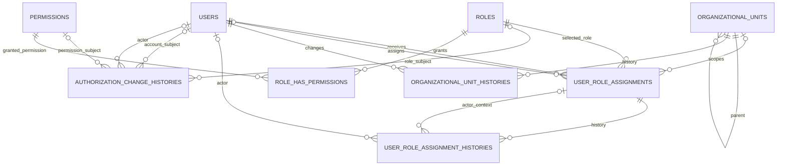

# 32 — Review Desain T4.2.1: Organisasi, Pengguna, Role, Permission, dan Scoped Assignment

**Versi dokumentasi:** 3.5.0  
**Tanggal review:** 5 November 2026  
**Status:** Desain dan integrasi disetujui pemilik; baseline migration/model/seeder telah dibuat.  
**Status implementasi:** Migration/seeder dan integrity smoke tests PASS pada PostgreSQL disposable yang disetujui; seluruh migration di-rollback. Fondasi `ScopedAuthorizationService` kini tersedia dan memiliki unit tests; Policy dan PostgreSQL service integration belum dibuat/dijalankan.

## 1. Hasil review

Keputusan bisnis yang telah disetujui konsisten dengan satu sumber assignment:

- Opsi A dipertahankan. `user_role_assignments` adalah satu-satunya sumber assignment user-role-unit.
- Spatie Laravel Permission mengelola katalog role/permission dan relasi role-permission.
- `model_has_roles`, `model_has_permissions`, direct grant per-user, dan Spatie Teams tidak digunakan untuk authorization DISTRIVA.
- Entitas bisnis dan `users` memakai UUID; ID katalog role dan permission Spatie memakai BIGINT.
- Hanya `SYS_ADMIN` yang boleh memiliki assignment global tanpa unit. Role operasional wajib memiliki unit.
- Pengguna boleh memiliki beberapa role dan unit, termasuk assignment dengan periode berlaku berbeda.
- Setiap keputusan authorization wajib memeriksa status akun, status dan tanggal assignment, permission role, status/scope unit organisasi, serta resource target.

Baseline source menggunakan Laravel Framework 13.40.0, Sanctum 4.3.3, Spatie Permission 8.3.2, dan guard canonical `web`. Unit test memverifikasi guard, konfigurasi catalog-only, normalisasi email, serta model UUID. Runtime migration, seeder idempotency, dan integrity smoke tests telah diuji pada PostgreSQL 18.6 disposable. `btree_gist` dipasang setelah izin eksplisit dan tetap terpasang setelah rollback. Sanctum UUID end-to-end dan production privilege/configuration belum diuji; permission keys tetap menunggu T4.4.

## 2. Struktur tabel pada baseline implementasi

| Tabel | Kunci dan tujuan |
|---|---|
| `users` | PK UUID; identitas, email unik yang dinormalisasi, NIP opsional yang unik, password hash, status akun, dan timestamp autentikasi. |
| `organizational_units` | PK UUID; kode resmi unik, nama, `unit_type` (`UP3`/`ULP`), self-FK `parent_id` nullable, status aktif, dan alamat. UP3 tanpa parent; ULP wajib menunjuk UP3. |
| `organizational_unit_histories` | PK UUID; FK unit, atribut sebelum/sesudah (kode, nama, tipe, parent, status aktif), alasan, FK aktor user, dan waktu perubahan. Append-only melalui operasi aplikasi. |
| `roles` | Katalog Spatie dengan PK BIGINT, unique `(name, guard_name)`, ditambah `description` dan `requires_unit_scope` DISTRIVA. Hanya `SYS_ADMIN` bernilai `requires_unit_scope=false`. |
| `permissions` | Katalog Spatie dengan PK BIGINT dan unique `(name, guard_name)`. |
| `role_has_permissions` | Relasi katalog Spatie, FK role dan permission BIGINT. Ini satu-satunya relasi pemberian permission. |
| `user_role_assignments` | PK UUID; FK user UUID, FK role BIGINT, FK unit UUID nullable, `valid_from`/`valid_until` inklusif, `is_active`, FK pemberi assignment, referensi dokumen, dan timestamps. |
| `user_role_assignment_histories` | PK UUID; FK assignment, jenis event/aksi, JSONB sebelum/sesudah, alasan, FK aktor user, FK opsional assignment aktor, dan timestamp. Catat create/change/deactivate; jangan simpan kredensial, token, atau secret dalam snapshot. |
| `authorization_change_histories` | PK UUID; event `USER_STATUS_CHANGED`, `ROLE_METADATA_CHANGED`, `PERMISSION_CATALOG_CHANGED`, `ROLE_PERMISSION_GRANTED`, atau `ROLE_PERMISSION_REVOKED`; nullable target FK ke user/role/permission, aktor user, JSONB sebelum/sesudah, alasan, dan timestamp. CHECK mengharuskan target user saja untuk event status user, role saja untuk metadata role, permission saja untuk catalog permission, serta role+permission untuk grant/revoke. Append-only. |
| `personal_access_tokens` | Tabel token Sanctum; `tokenable_id` harus kompatibel dengan UUID `users.id`; validasi dengan versi Sanctum yang dipasang. |

`model_has_roles` dan `model_has_permissions` sengaja tidak dibuat. T4.2.1 juga tidak menambahkan tabel vendor-company/project baru: role `VENDOR` tetap memerlukan assignment unit, sedangkan batas perusahaan/proyek/WO ditegakkan melalui relasi domain dan policy pada saat domain tersebut difinalkan.

### Integritas dan indeks

- Batasi penghapusan user, unit, role, dan assignment yang dirujuk histori atau transaksi; nonaktifkan, jangan hapus record operasional.
- Normalisasi email ke lowercase dan tegakkan keunikan case-insensitive; NIP boleh NULL dan unik jika terisi; kode unit unik.
- Validasi tipe parent unit dan kecocokan nullability unit dengan role secara transaksional serta pada batas database (trigger atau mekanisme setara yang diuji).
- Tegakkan `valid_until IS NULL OR valid_until >= valid_from`.
- Cegah rentang tanggal aktif yang overlap untuk kombinasi user-role-unit yang sama. Usulan PostgreSQL: exclusion constraint `btree_gist` untuk assignment berscope dan constraint global terpisah saat `organizational_unit_id IS NULL`. Rentang tanggal inklusif memperbolehkan assignment baru mulai sehari setelah `valid_until` sebelumnya.
- Perlakukan `btree_gist` sebagai prasyarat environment yang perlu diverifikasi/dipenuhi; jangan diam-diam memasang atau menghapus extension bersama melalui migration aplikasi.
- Indeks lookup assignment berdasarkan user/status, unit/status, role/status, dan user/unit; tambahkan GiST index yang dibutuhkan exclusion constraint.

## 3. ERD

`personal_access_tokens` berelasi secara polymorphic ke identitas user UUID. Diagram tidak menyiratkan penggunaan pivot user-role Spatie.

## 4. Integrasi Spatie tanpa sumber assignment kedua

1. Kunci versi `spatie/laravel-permission` yang kompatibel setelah baseline Laravel/PHP aktual tersedia; periksa migration dan konfigurasi package versi tersebut.
2. Pertahankan tabel/model katalog `roles`, `permissions`, dan `role_has_permissions`. Tambahkan metadata role `description` dan `requires_unit_scope`.
3. Jangan menggunakan migration default package tanpa penyesuaian bila migration itu membuat pivot assignment user. Publish/sesuaikan migration agar tidak membuat `model_has_roles` dan `model_has_permissions`; jangan aktifkan Teams.
4. Jangan menambahkan trait Spatie `HasRoles` pada model `User` DISTRIVA; jangan memanggil `assignRole`, `syncRoles`, API direct permission, middleware role, atau default `can()` permission resolution sebagai jalur assignment/authorization.
5. Atur `register_permission_check_method` Spatie menjadi `false` agar pemeriksaan default package tidak menjadikan pivot package sebagai sumber otorisasi. Laravel Policy memanggil `ScopedAuthorizationService` DISTRIVA yang menghubungkan assignment efektif dengan katalog role-permission.
6. API role/permission Spatie hanya dipakai untuk katalog dan seeding/pengelolaan relasi role-permission. Bersihkan cache katalog Spatie setelah perubahan katalog; invalidasi cache scope DISTRIVA terpisah setelah assignment, akun, unit, atau role-permission berubah.
7. Gunakan satu guard canonical untuk katalog. Nilai pasti `guard_name` ditetapkan setelah konfigurasi auth Laravel tersedia; jangan membuat katalog role duplikat untuk `web` dan `sanctum` berdasarkan asumsi.
8. Gunakan token key polymorphic Sanctum yang kompatibel UUID dan uji pembuatan/autentikasi token dengan versi package yang benar-benar dipasang.

Dokumentasi Spatie yang ditinjau: [Custom Permission Check](https://spatie.be/docs/laravel-permission/v6/advanced-usage/custom-permission-check) menjelaskan penonaktifan pemeriksaan permission default saat memakai custom authorization logic; [UUID/ULID](https://spatie.be/docs/laravel-permission/v6/advanced-usage/uuid) menjelaskan penyesuaian tipe migration bila pivot package merujuk user UUID. DISTRIVA mengusulkan untuk tidak membuat pivot tersebut.

## 5. Strategi authorization dan organizational scope

Service authorization backend mengevaluasi satu permintaan dengan semua kondisi berikut:

1. User terautentikasi ada dan `account_status = ACTIVE`.
2. Assignment yang cocok aktif dan berlaku pada tanggal bisnis (Asia/Jakarta): `valid_from <= today` dan `valid_until IS NULL OR valid_until >= today`.
3. Role sesuai guard yang dikonfigurasi dan memiliki permission yang diminta melalui `role_has_permissions`.
4. Role operasional memiliki unit organisasi yang aktif. `SYS_ADMIN` boleh tanpa unit, tetapi tidak memperoleh akses dokumen bisnis atau kewenangan approval secara implisit.
5. Unit assignment dan unit pada resource target harus memenuhi aturan scope untuk tindakan tersebut. Hierarki UP3-ULP tidak otomatis memberikan approval atau akses tanpa batas.
6. Batas domain juga berlaku: misalnya vendor harus cocok dengan vendor company serta proyek/WO yang ditugaskan; kecocokan unit saja tidak cukup.

Laravel Policy menerapkan pemeriksaan pada read dan mutation. Service daftar/query membatasi baris sesuai scope sebelum pagination. Pemeriksaan permission saja tanpa konteks target tidak cukup untuk mengizinkan akses record bisnis. Jika tidak ada grant, assignment inactive/expired, user/unit inactive, permission hilang, atau scope mismatch, permintaan harus ditolak.

Perubahan assignment ditulis melalui domain service dalam transaksi dan menambahkan event ke `user_role_assignment_histories`. Perubahan status akun dan katalog/relasi permission dicatat ke `authorization_change_histories`; perubahan organisasi tetap dicatat di `organizational_unit_histories`. Tulis perubahan bisnis dan histori dalam transaksi yang sama. Baris histori tidak dapat diedit/dihapus melalui alur aplikasi biasa. Invalidasi cache dilakukan setelah perubahan berhasil commit atau melalui mekanisme after-commit yang andal.

## 6. Urutan migration dan seeder

### Urutan migration

1. Konfirmasi versi Laravel, PHP, Spatie, dan Sanctum; konfigurasi UUID model key serta satu guard authorization canonical.
2. Provision/verifikasi kemampuan `btree_gist` PostgreSQL bersama database owner; jangan memakai database produksi untuk validasi desain.
3. Buat `users`.
4. Buat `organizational_units` dengan self-FK, checks, dan indeks dasar.
5. Buat tabel Spatie yang disesuaikan: hanya `roles`, `permissions`, dan `role_has_permissions`; tambahkan metadata role.
6. Buat `organizational_unit_histories`.
7. Buat `user_role_assignments`.
8. Buat `user_role_assignment_histories`.
9. Buat `authorization_change_histories` setelah users, roles, dan permissions tersedia.
10. Tambahkan trigger/constraint teruji untuk tipe parent, kecocokan role-scope, overlap assignment, dan konsistensi tipe target authorization-history.
11. Buat `personal_access_tokens` Sanctum dengan `tokenable_id` UUID-compatible.

Provisioning extension dipisahkan jika role deployment tidak berhak membuat extension. Rollback tidak boleh menghapus extension yang sudah digunakan bersama.

### Urutan seeder

1. Seed idempotent 14 role catalog dengan `requires_unit_scope` dan guard canonical terpilih.
2. Seed permission catalog yang disetujui dan mapping role-permission dari matriks authorization T4.4 yang sudah disetujui; catat perubahan katalog/mapping melalui audit event.
3. Bersihkan cache katalog Spatie dan invalidasi cache authorization DISTRIVA.
4. Muat unit organisasi hanya dari sumber data resmi yang diverifikasi.
5. Buat/assign user nyata melalui proses bootstrap/admin yang disetujui; jangan seed placeholder user, password, unit produksi, atau assignment pengguna. Factory test boleh membuat data terisolasi.

## 7. Daftar test

| Area | Kasus wajib |
|---|---|
| Schema/package | Migration up/down pada database kosong; migration Spatie aktual tidak membuat pivot assignment user; key role-permission BIGINT; Sanctum UUID token dibuat dan diautentikasi. |
| Katalog | Nama role/permission unik dalam guard canonical; seed idempotent; perubahan role-permission menginvalidasi kedua cache terkait. |
| User | Email lowercase/case-insensitive unik; NIP nullable unique; user pending/suspended/inactive ditolak. |
| Organisasi | UP3 tanpa parent; ULP dengan parent UP3 aktif; tolak parent tipe salah/nonaktif, perubahan parent invalid, dan penghapusan unit yang sudah direferensikan; perubahan atribut organisasi tercatat before/after. |
| Integritas assignment | Role operasional tidak boleh tanpa unit; SYS_ADMIN boleh; SYS_ADMIN tidak memperoleh akses bisnis implisit; rentang tanggal invalid ditolak. |
| Assignment efektif | Sebelum/dalam/sesudah periode; assignment inactive; unit inactive; multi-role/multi-unit; perubahan status akun. |
| Overlap/concurrency | Overlap aktif kombinasi user-role-unit yang sama ditolak; tanggal bersebelahan diterima; perilaku histori inactive didefinisikan; assignment global NULL-unit ditolak secara terpisah, termasuk insert concurrent. |
| Permission dan scope | Permission hanya dari role; permission hilang/salah ditolak; isolasi ULP; scope UP3-ULP yang eksplisit; query daftar dibatasi sebelum pagination; tidak ada kenaikan kewenangan approval otomatis. |
| Vendor | Kecocokan unit saja tidak cukup; relasi vendor company dan proyek/WO yang ditugaskan ditegakkan. |
| Audit | Assignment, perubahan status akun, permission catalog dan role-permission mencatat before/after, reason, actor dan konteks actor yang relevan; transaksi atomic; enforcement append-only; tidak ada secret di histori. |
| Cache/regresi | Perubahan assignment, unit, status user, dan role-permission memperbarui akses efektif; akses revoke/expired tidak dilayani dari cache stale. |

## 8. Dokumentasi yang disinkronkan untuk v3.5.0

- `README.md`
- `docs/03-ROLES-AND-ACCESS.md`
- `docs/14-DEVELOPMENT-ROADMAP.md`
- `docs/15-DECISIONS-AND-OPEN-ISSUES.md`
- `docs/17-T4-TECHNICAL-DESIGN-STATUS.md`
- `docs/18-CHANGELOG-AND-SUPERSEDED-DECISIONS.md`
- `docs/20-LOCAL-DEVELOPMENT-ENVIRONMENT-AS-BUILT.md`
- `docs/22-T4.2.1-FOUNDATION-SCHEMA.md`
- `test-evidence/2026-11-05-t421-runtime.md`
- `test-evidence/2026-11-05-t4211-authorization.md`
- `docs/32-T4.2.1-DESIGN-REVIEW.md`
- `docs/AI-HANDOFF.md`
- `docs/PROJECT-CONTEXT-FOR-AI.md`
- `PROMPT_MASTER_DISTRIVA_AI_DEVELOPMENT.md`
- `docs/33-T4.2.1.1-SCOPED-AUTHORIZATION.md`
- `PACKAGE-MANIFEST.json`

Schema T4.2.2–T4.2.4 dan keputusan bisnisnya tidak diubah oleh review ini. Statusnya tetap sebagaimana tercatat pada handoff/status teknis; bukti PostgreSQL T4.2.4 yang terbatas tidak membuktikan migration upstream siap produksi.
Paket dokumentasi v3.5.0 ditambahkan secara aditif ke repository; tidak dibuat arsip ZIP baru sesuai arahan pemilik. Arsip v3.4.0 yang sudah ada tidak diperbarui dan tetap menjadi snapshot lama.

## 9. Gerbang persetujuan dan verifikasi implementasi

Pemilik telah menyetujui desain/integrasi T4.2.1 dan baseline migration telah dibuat. Persetujuan desain ini **tidak** mengizinkan migration dijalankan pada database yang belum disebutkan dan disetujui secara terpisah. Sebelum runtime, konfirmasi target disposable dan verifikasi `btree_gist`; jangan menargetkan database lain secara implisit.

Pekerjaan tersisa setelah v3.5.0:

1. Implementasikan Laravel Policies untuk permission keys yang telah disetujui; setiap Policy harus menyediakan konteks unit/resource yang benar.
2. Sediakan schema/model relasi vendor-company/project/work-order dan ganti vendor deny-all dengan resolver yang memverifikasi ketiganya.
3. Implementasikan assignment/unit write services, audit transaksi atomik, dan invalidasi cache setelah commit.
4. Finalkan permission keys pada T4.4 dan mapping role-permission melalui matriks yang disetujui.
5. Jalankan PostgreSQL integration tests, concurrency stress, dan Sanctum UUID end-to-end hanya pada target disposable yang diidentifikasi dan disetujui terpisah.
6. Selesaikan kebijakan penggunaan ulang kode unit.

Validasi v3.5.0: full suite 20/20 tests (30 assertions), termasuk 15 unit tests authorization (20 assertions); `php artisan route:list`, `composer validate --strict`, PHP syntax, Pint, dan service container resolution PASS. Tidak ada database runtime untuk service baru. Hasil migration/seeder/smoke tests PostgreSQL sebelumnya tetap terbatas pada disposable target dan telah di-rollback; tidak mengesahkan perubahan service atau production readiness.

### Addendum v3.6.0

T4.2.1.2 policy/resource-scope matrix disetujui sebagai baseline desain saja. Permission keys, seeder, Policy/query scope, dan domain routes belum diimplementasikan atau disetujui untuk implementasi. Audit menemukan domain resource bisnis belum tersedia di backend. Lihat `34-T4.2.1.2-AUTHORIZATION-POLICY-DESIGN.md`; audit evidence `test-evidence/2026-11-05-t4212-design-audit.md`. Tidak ada tes atau database runtime baru pada checkpoint ini.
