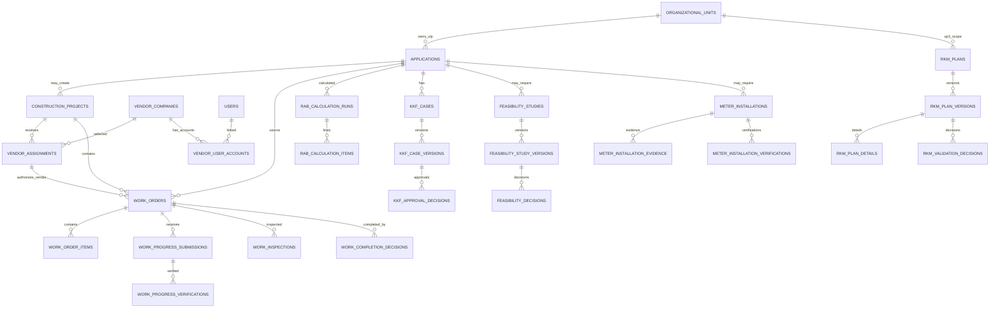

# 35 — O-034 Resource Model, Lifecycle, and Domain Schema

**Project:** DISTRIVA — Distribution Management Platform  
**Design baseline:** v3.7.1  
**Latest additive recommendation update:** v3.11.0
**Tanggal penyusunan:** 5 November 2026  
**Status:** PROPOSED DOMAIN DESIGN — untuk review dan persetujuan pemilik proses  
**Tujuan:** Menyediakan model resource, relasi persisten, lifecycle, dan invariant domain yang diperlukan sebelum permission catalog, Laravel Policy, dan SQL query scope difinalkan.

---

## 1. Ringkasan dan batas dokumen

Dokumen ini melengkapi rancangan domain bisnis yang belum tersedia sebagai schema/model pada checkpoint Authorization Design v3.7.1. Dokumen ini **bukan** persetujuan migration, seeder, permission identifier, role grant, Policy, route, atau implementasi aplikasi.

### 1.1 Sasaran

1. Menetapkan resource bisnis persisten yang menjadi target authorization.
2. Menetapkan relasi FK yang dapat membuktikan konteks application, ULP, UP3, versi input, vendor, project, dan Work Order.
3. Menetapkan lifecycle minimum dan aturan versioning/approval agar Policy tidak menebak status bisnis.
4. Menetapkan invariant lintas domain dan batas transaksi.
5. Memisahkan keputusan yang sudah disetujui dari proposal teknis dan keputusan aktor yang masih terbuka.

### 1.2 Di luar cakupan

- Finalisasi permission keys dan role-permission grants (dependensi T4.4).
- Implementasi Laravel model, migration, seeder, controller, Policy, middleware, query scope, job, dan API.
- Penetapan aktor yang masih `NEEDS_CONFIRMATION`.
- Desain procurement/PO, inventory transaction, warehouse issue/return, atau integrasi ERP secara penuh.
- Perubahan database atau pengujian runtime baru.

### 1.3 Label status

| Label | Arti |
|---|---|
| `APPROVED` | Keputusan bisnis telah tercatat pada dokumen sumber yang dirujuk |
| `PROPOSED` | Usulan struktur teknis pada dokumen ini; belum disetujui |
| `NEEDS_CONFIRMATION` | Aktor, aturan, atau detail proses belum diputuskan |
| `BLOCKED` | Tidak boleh diimplementasikan sebelum dependensi/keputusan selesai |
| `INHERITED` | Menggunakan schema/domain yang telah dirancang pada dokumen upstream |

---

## 2. Prinsip desain lintas domain

1. **Persisted context is authoritative.** Unit, application, vendor, project, assignment, dan status harus dibaca dari relasi database yang tersimpan, bukan dari ID/unit yang dikirim klien.
2. **UUID konsisten untuk entitas bisnis.** Mengikuti T4.2.1, primary key entitas domain baru menggunakan UUID kecuali ada alasan kompatibilitas yang disetujui.
3. **Tidak membuat ulang fondasi.** Reuse `users`, `organizational_units`, `user_role_assignments`, `applications`, master material/KHS/BOM, dan document subsystem.
4. **ULP adalah unit operasional permohonan.** `applications.organizational_unit_id` harus menunjuk ULP. UP3 diperoleh melalui parent ULP; hindari penyimpanan redundan kecuali sebagai snapshot historis yang disengaja.
5. **Versioned business inputs are immutable after approval.** Perubahan membuat versi baru; keputusan approval melekat pada versi/snapshot yang tepat.
6. **Approval bukan status generik.** Approval harus menyimpan workflow step, actor, assignment context, keputusan, waktu, catatan, dan versi yang diputuskan.
7. **AND approval requires distinct users.** Semua approver pada satu tahap AND harus merupakan user berbeda. Submitter tidak boleh menjadi final approver versinya sendiri.
8. **No implicit downstream side effect.** RKM approval bukan PO; vendor assignment approval bukan WO approval/issue; document approval bukan KKF approval.
9. **Fail closed.** Relasi wajib tidak lengkap, status tidak dikenal, versi tidak cocok, atau actor belum diputuskan berarti aksi ditolak/ditahan.
10. **History is append-only at the application layer.** Jangan menghapus jejak keputusan, assignment, revisi, progress, atau integrasi.

---

## 3. Dependency map — reuse schema yang sudah ada

| Domain | Resource/table existing design | Source | Perlakuan |
|---|---|---|---|
| Identity & organization | `users`, `roles`, `permissions`, `organizational_units`, `user_role_assignments`, histories | `22-T4.2.1-FOUNDATION-SCHEMA.md` | `INHERITED`; jangan dibuat ulang |
| Customer & application | `customers`, `customer_external_references`, `applications`, application references/status/payment/survey/task | `24-T4.2.3` | `INHERITED`; application menjadi root proses PB/PD |
| Material & technical master | `materials`, `units_of_measure`, KHS versions, construction versions, BOM/formula | `23-T4.2.2` | `INHERITED`; master KHS/BOM approved oleh `UP3_MANAGER` |
| Document & review | `application_documents`, versions, review cycles, actor snapshots | `26-T4.2.4` | `INHERITED`; file private dan versi immutable |
| Auto MTO | package, job, extraction, item, material requirements, verification, snapshot, approval history | `26-T4.2.4` | `INHERITED`; MTO verified oleh petugas teknis ULP dan snapshot disetujui `MANAGER_ULP` sesuai desain |
| Authorization | `ScopedAuthorizationService` dan assignment/org models | `33` dan `34` | Service tersedia; domain Policy/query belum tersedia |

### 3.1 Integritas upstream yang harus dipertahankan

- `applications.organizational_unit_id` menunjuk unit `ULP`.
- `application_documents` dan Auto MTO package/version terikat pada application yang sama.
- `materials.unit` pada T4.2.2 masih `VARCHAR(30)`; jangan mengasumsikan `materials.unit_id`.
- KHS/BOM dan material requirement harus merujuk versi master yang konsisten.
- Application external status Bot Daftung tidak boleh menimpa `applications.current_status`.
- Sinkronisasi Bot Daftung status existing hanya boleh memperbarui tiga atribut yang telah di-allowlist pada T4.2.3.
- T4.2.4 runtime PASS memakai contract-minimal fixtures; bukan bukti bahwa seluruh schema upstream telah menjadi migration produksi.

---

## 4. Domain RKM — Rencana Kebutuhan Material

**Status keputusan proses:** alur utama `APPROVED`; schema rinci di bawah `PROPOSED`; concrete ULP proposer role masih `NEEDS_CONFIRMATION`.

### 4.1 Konsep

RKM adalah rencana kebutuhan material terencana untuk satu UP3 dan satu periode/perencanaan. RKM dapat mengonsolidasikan kebutuhan dari beberapa ULP anak. Detail kebutuhan tetap menyimpan asal ULP agar konsolidasi tidak menghilangkan ownership dan tidak memberi hak mutasi lintas ULP.

Approval RKM tidak membuat PO, tidak menerbitkan WO, dan tidak otomatis mengubah saldo/stok.

### 4.2 Tabel yang diusulkan

#### `rkm_plans` — identitas rencana

| Kolom | Tipe | Aturan |
|---|---|---|
| `id` | UUID | PK |
| `plan_number` | VARCHAR(50) | Unique business number |
| `organizational_unit_id` | UUID | FK `organizational_units`; wajib unit `UP3` |
| `planning_year` | SMALLINT | Tahun rencana |
| `planning_period_type` | VARCHAR(20) | `ANNUAL`, `QUARTERLY`, `SEMESTER`, atau tipe yang disetujui |
| `period_number` | SMALLINT NULL | Nomor periode jika relevan |
| `current_version_id` | UUID NULL | Pointer versi aktif/terkini; composite FK ke versi milik plan |
| `status` | VARCHAR(30) | Status agregat plan |
| `created_by` | UUID | FK `users` |
| timestamps | TIMESTAMPTZ | |

Constraint proposal: unit harus `UP3`; kombinasi business key periode tidak boleh duplikat sesuai aturan satu rencana per UP3/periode. Definisi apakah beberapa RKM dapat dibuat dalam periode sama masih perlu konfirmasi proses.

#### `rkm_plan_versions` — versi dan snapshot rencana

| Kolom | Tipe | Aturan |
|---|---|---|
| `id` | UUID | PK |
| `rkm_plan_id` | UUID | FK `rkm_plans` |
| `version_number` | INTEGER | Unique per plan |
| `previous_version_id` | UUID NULL | Versi sebelumnya dari plan yang sama |
| `status` | VARCHAR(30) | `DRAFT`, `SUBMITTED`, `VALIDATING`, `RETURNED`, `APPROVED`, `REJECTED`, `SUPERSEDED` |
| `planning_basis_snapshot` | JSONB | Snapshot parameter/basis yang dipakai |
| `submitted_by` / `submitted_at` | UUID / TIMESTAMPTZ NULL | Actor submit |
| `approved_at` | TIMESTAMPTZ NULL | Waktu final approval |
| `revision_reason` | TEXT NULL | Wajib untuk versi revisi |
| timestamps | TIMESTAMPTZ | |

Versi `APPROVED` immutable. Perubahan setelah approval menghasilkan versi baru. Snapshot harus menyimpan hash dan referensi data sumber agar perhitungan dapat direproduksi.

#### `rkm_plan_details` — kebutuhan per ULP/material

| Kolom | Tipe | Aturan |
|---|---|---|
| `id` | UUID | PK |
| `rkm_plan_version_id` | UUID | FK versi RKM |
| `organizational_unit_id` | UUID | FK unit; wajib `ULP` dengan parent UP3 sama dengan RKM |
| `material_id` | UUID | FK `materials` |
| `unit_id` | UUID | FK `units_of_measure` |
| `forecast_quantity` | NUMERIC(24,9) | Kebutuhan hasil forecast |
| `manual_adjustment_quantity` | NUMERIC(24,9) | Default 0; perubahan harus beralasan |
| `planned_quantity` | NUMERIC(24,9) | Nilai rencana final |
| `source_snapshot` | JSONB | Snapshot forecast/demand/stock yang dipakai |
| `adjustment_reason` | TEXT NULL | Wajib bila adjustment bukan nol |
| timestamps | TIMESTAMPTZ | |

Kuantitas tidak boleh negatif kecuali terdapat kebijakan koreksi/retur yang eksplisit. Material dan satuan harus cocok dengan master/konversi yang disetujui. Jangan menganggap RKM sebagai transaksi stok.

#### `rkm_validation_decisions` — validasi dan final approval

| Kolom | Tipe | Aturan |
|---|---|---|
| `id` | UUID | PK |
| `rkm_plan_version_id` | UUID | FK versi yang sama |
| `stage_code` | VARCHAR(40) | `PLANNING_VALIDATION`, `CONSTRUCTION_VALIDATION`, `FINAL_APPROVAL` |
| `decision` | VARCHAR(20) | `APPROVED`, `REJECTED`, `RETURNED` |
| `actor_user_id` | UUID | FK `users` |
| `actor_assignment_id` | UUID | FK `user_role_assignments` |
| `actor_role_id` | BIGINT | FK role snapshot |
| `actor_unit_id` | UUID | FK unit snapshot |
| `notes` | TEXT NULL | Catatan/justifikasi |
| `decided_at` | TIMESTAMPTZ | |
| `snapshot_hash` | CHAR(64) | Hash versi yang diputuskan |

Unique proposal: satu keputusan final per actor/stage/version; keputusan ulang mengikuti aturan cycle yang kelak disetujui, bukan overwrite baris lama.

### 4.3 Workflow RKM yang sudah diputuskan

1. ULP menyiapkan dan mengajukan usulan RKM.
2. `PERENCANAAN` UP3 melakukan validasi.
3. `KONSTRUKSI_UP3` UP3 melakukan validasi.
4. Dua validator wajib user berbeda dan memutuskan versi yang sama.
5. `UP3_MANAGER` memberikan final approval/rejection setelah kedua validasi lengkap.
6. Submitter tidak boleh menjadi final approver versinya sendiri.
7. Perubahan setelah approved membuat versi baru dan mengulang kedua validasi serta final approval.
8. Approval RKM tidak memicu procurement/PO.

**Masih terbuka:** role konkret ULP proposer; aturan jumlah RKM dalam satu periode; sumber resmi forecast/stock snapshot; apakah periode dapat overlap; dan lifecycle revisi/cancel.

---

## 5. Vendor, Project, dan Vendor Assignment

**Status:** workflow pemilih/approver `APPROVED`; domain schema `PROPOSED`; vendor authorization `BLOCKED` sampai relasi aktual tersedia dan diverifikasi.

### 5.1 Tabel yang diusulkan

#### `vendor_companies`

Identitas badan usaha/vendor yang terdaftar.

- `id UUID PK`
- `company_code VARCHAR(50) UNIQUE`
- `legal_name VARCHAR(200)`
- `tax_identifier VARCHAR(50) NULL` — klasifikasi dan proteksi data perlu kebijakan
- `status VARCHAR(20)` — `PENDING`, `ACTIVE`, `SUSPENDED`, `INACTIVE`
- `source_reference VARCHAR(150) NULL`
- timestamps

Tidak menyimpan credential login vendor pada tabel ini.

#### `vendor_user_accounts`

Penghubung akun DISTRIVA dengan perusahaan vendor.

- `id UUID PK`
- `user_id UUID FK users`
- `vendor_company_id UUID FK vendor_companies`
- `valid_from DATE`
- `valid_until DATE NULL`
- `status VARCHAR(20)`
- `verified_by UUID NULL FK users`
- `verified_at TIMESTAMPTZ NULL`
- timestamps

Relasi akun-user harus diverifikasi melalui proses resmi. Akun yang tidak memiliki relasi aktif tidak dapat bertindak sebagai vendor.

#### `construction_projects`

- `id UUID PK`
- `project_number VARCHAR(60) UNIQUE`
- `application_id UUID FK applications`
- `organizational_unit_id UUID FK organizational_units` — harus sama dengan ULP application
- `project_type VARCHAR(40)`
- `status VARCHAR(30)`
- `source_reference VARCHAR(150) NULL`
- `created_by UUID FK users`
- timestamps

Satu application dapat memiliki satu atau beberapa project hanya jika jenis proses memang memerlukannya; kardinalitas final perlu dikonfirmasi. Jangan membuat project hanya dari nilai request tanpa application persisted.

#### `vendor_assignments`

- `id UUID PK`
- `construction_project_id UUID FK construction_projects`
- `vendor_company_id UUID FK vendor_companies`
- `assignment_number VARCHAR(60) UNIQUE`
- `version_number INTEGER`
- `status VARCHAR(30)` — `DRAFT`, `PENDING_APPROVAL`, `APPROVED`, `REJECTED`, `REVOKED`, `SUPERSEDED`
- `selected_by UUID FK users`
- `selected_at TIMESTAMPTZ`
- `selection_reason TEXT`
- `approved_by UUID NULL FK users`
- `approved_at TIMESTAMPTZ NULL`
- `decision_notes TEXT NULL`
- timestamps

Assignment baru hanya efektif setelah disetujui. Pemilihan vendor dilakukan `KONSTRUKSI_UP3`; keputusan approve/reject oleh `ASMAN_KONSTRUKSI`. User-level separation antara pemilih dan approver masih perlu konfirmasi jika satu user memiliki multi-role.

### 5.2 Vendor eligibility dan scope

Vendor eligibility harus mempertimbangkan status perusahaan, masa berlaku/kelayakan kontrak, kapasitas, project, dan aturan bisnis yang telah ditentukan. Field kontrak/capacity belum dimodelkan secara final karena sumber dan owner data belum dipastikan.

**Invariant wajib:** vendor hanya dapat membaca/mengirim progress untuk WO yang memiliki relasi persisted dan valid:
`authenticated user -> active vendor_user_account -> vendor_company -> approved vendor_assignment -> construction_project -> work_order`.

Tidak cukup hanya mencocokkan unit UP3/ULP. Sampai relasi dan Policy benar-benar ada, vendor tetap deny-all.

---

## 6. Work Order, Progress, Inspection, Completion

**Status:** workflow sebagian `APPROVED`; creator/reviewer/issuer WO `NEEDS_CONFIRMATION`; implementasi `BLOCKED` oleh O-039 dan O-034.

### 6.1 `work_orders`

| Kolom | Tipe | Aturan |
|---|---|---|
| `id` | UUID | PK |
| `work_order_number` | VARCHAR(60) | Unique |
| `construction_project_id` | UUID | FK project |
| `application_id` | UUID | FK application; harus cocok dengan project |
| `organizational_unit_id` | UUID | FK ULP; harus cocok dengan application/project |
| `vendor_assignment_id` | UUID | FK assignment yang approved |
| `drawing_document_id` | UUID NULL | Referensi dokumen gambar |
| `drawing_version_id` | UUID NULL | Versi gambar yang dikunci |
| `auto_mto_package_id` | UUID NULL | Paket MTO yang menjadi input |
| `auto_mto_snapshot_id` | UUID NULL | Snapshot MTO yang disetujui |
| `rab_calculation_run_id` | UUID NULL | RAB run yang dipakai |
| `status` | VARCHAR(30) | Lifecycle WO |
| `scope_snapshot` | JSONB | Snapshot ruang lingkup/pekerjaan |
| `created_by` | UUID FK users | Actor pembuat |
| `reviewed_by` | UUID NULL FK users | Actor reviewer, role belum ditentukan |
| `issued_by` | UUID NULL FK users | Actor penerbit, role belum ditentukan |
| `issued_at` | TIMESTAMPTZ NULL | Waktu penerbitan |
| timestamps | TIMESTAMPTZ | |

Kolom referensi versi sebaiknya memakai FK komposit/constraint untuk memastikan seluruh input berasal dari application/project yang sama. Nama tabel/PK Auto MTO harus disesuaikan dengan implementasi DDL final T4.2.4, bukan ditebak dari label.

### 6.2 `work_order_items`

- `id UUID PK`
- `work_order_id UUID FK work_orders`
- `source_type VARCHAR(30)` — referensi ke item MTO/BOM/RAB yang disetujui
- `source_item_id UUID` — target harus diverifikasi melalui FK/relasi eksplisit per source type; hindari polymorphic FK tanpa integritas
- `description_snapshot TEXT`
- `quantity NUMERIC(24,9)`
- `unit_id UUID FK units_of_measure`
- `sequence INTEGER`
- timestamps

Jika beberapa jenis sumber digunakan, lebih aman membuat tabel penghubung khusus (mis. `work_order_item_mto_sources`, `work_order_item_rab_sources`) daripada satu `source_item_id` polymorphic yang tidak dapat ditegakkan FK-nya.

### 6.3 `work_order_status_histories`

- `id UUID PK`
- `work_order_id UUID FK`
- `from_status VARCHAR(30) NULL`
- `to_status VARCHAR(30)`
- `actor_user_id UUID NULL FK users`
- `actor_assignment_id UUID NULL FK user_role_assignments`
- `reason TEXT NULL`
- `changed_at TIMESTAMPTZ`

Setiap transisi status harus atomik dengan perubahan status terkini.

### 6.4 `work_progress_submissions`

- `id UUID PK`
- `work_order_id UUID FK`
- `submitted_by UUID FK users`
- `submitter_type VARCHAR(20)` — `VENDOR`, `INTERNAL`
- `vendor_company_id UUID NULL FK vendor_companies`
- `submission_number INTEGER`
- `progress_date DATE`
- `progress_percent NUMERIC(5,2) NULL`
- `stage_code VARCHAR(50) NULL`
- `description TEXT`
- `evidence_document_id UUID NULL` — referensi document subsystem
- `evidence_version_id UUID NULL`
- `payload_snapshot JSONB`
- `payload_hash CHAR(64)`
- `status VARCHAR(20)` — `SUBMITTED`, `VERIFIED`, `REJECTED`, `SUPERSEDED`
- `submitted_at TIMESTAMPTZ`
- timestamps

Progress vendor harus menyimpan identitas vendor company yang berasal dari relasi akun aktif, bukan dari body request. Revision membuat submission baru; jangan overwrite submission lama.

### 6.5 `work_progress_verifications`

- `id UUID PK`
- `work_progress_submission_id UUID FK`
- `verified_by UUID FK users`
- `verifier_assignment_id UUID FK user_role_assignments`
- `verifier_unit_id UUID FK organizational_units`
- `decision VARCHAR(20)` — `VERIFIED`, `REJECTED`, `RETURNED`
- `notes TEXT`
- `verified_at TIMESTAMPTZ`
- `evidence_snapshot JSONB NULL`

**Keputusan APPROVED:** submitter progres dan verifier harus user berbeda. Setiap user dengan assignment efektif `KONSTRUKSI_UP3` pada UP3 terkait dapat memverifikasi progres WO di seluruh ULP anak UP3 tersebut tanpa assignment WO/task tambahan. Ini adalah scope aksi khusus; bukan `UP3_DESCENDANT_READ`, bukan akses baca umum, dan bukan mutation/approval generik.

### 6.6 `work_inspections`

- `id UUID PK`
- `work_order_id UUID FK`
- `inspection_number INTEGER`
- `inspected_by UUID FK users`
- `inspector_assignment_id UUID FK user_role_assignments`
- `inspection_date TIMESTAMPTZ`
- `result VARCHAR(20)` — `PASS`, `FAIL`, `CONDITIONAL`
- `checklist_snapshot JSONB`
- `findings TEXT NULL`
- `evidence_document_id UUID NULL`
- `evidence_version_id UUID NULL`
- timestamps

**Keputusan APPROVED:** inspeksi child-ULP WO merupakan aksi khusus `KONSTRUKSI_UP3` dengan cakupan UP3 assignment yang sama dan tanpa assignment WO/task tambahan. Inspector versus final approver berbeda user merupakan rekomendasi pada checkpoint v3.7.0, belum menjadi keputusan final.

### 6.7 `work_completion_decisions`

- `id UUID PK`
- `work_order_id UUID FK`
- `inspection_id UUID FK work_inspections`
- `meter_installation_verification_id UUID NULL` — FK setelah domain meter final
- `decision VARCHAR(20)` — `APPROVED`, `REJECTED`, `RETURNED`
- `decided_by UUID FK users`
- `decided_at TIMESTAMPTZ`
- `notes TEXT`
- `snapshot_hash CHAR(64)`

Role workflow final completion yang tercatat adalah `ASMAN_KONSTRUKSI`; boundary scope dan SoD inspector/final approver masih perlu konfirmasi. Keputusan completion tidak boleh dilakukan sebelum seluruh precondition, termasuk verifikasi meter bila diwajibkan, terpenuhi.

### 6.8 Lifecycle WO yang diusulkan

`DRAFT -> PENDING_REVIEW -> REVIEWED -> PENDING_ISSUE -> ISSUED -> IN_PROGRESS -> PENDING_INSPECTION -> INSPECTED -> PENDING_COMPLETION_APPROVAL -> COMPLETED`

Cabang terminal/pengecualian yang perlu aturan proses: `REJECTED`, `CANCELLED`, `ON_HOLD`, `RETURNED_FOR_REVISION`.

Status di atas `PROPOSED`, bukan enum final. Transisi harus ditetapkan eksplisit; jangan mengizinkan arbitrary status update. WO tidak boleh `ISSUED` sebelum vendor assignment approved dan referensi input versi yang diwajibkan valid. Kebutuhan material baru dikirim ke aplikasi material hanya setelah WO disetujui `ASMAN_KONSTRUKSI` dan diterbitkan sesuai T4.2.4/T3.8.

### 6.9 Hal yang wajib diputuskan untuk O-039

- Siapa pembuat/drafter WO?
- Siapa reviewer WO?
- Siapa yang berwenang menerbitkan/issue WO?
- Apakah WO memerlukan approval tersendiri, siapa approver, dan apa batasnya?
- Apakah creator, reviewer, issuer, dan approver wajib user berbeda?
- Apakah satu project/application dapat memiliki beberapa WO dan bagaimana pembagian scope/quantity?
- Apakah WO dapat diubah setelah issue; jika ya, bagaimana amendment/versioning dan dampaknya pada material requirement?
- Apakah WO dapat dibatalkan setelah issue dan bagaimana rekonsiliasi vendor/progress/material?

Semua pertanyaan tersebut `NEEDS_CONFIRMATION`; rekomendasi maker-checker bukan keputusan otomatis.

---

## 7. RAB — Calculation Run dan Snapshot

**Status:** prinsip reproduksibilitas/snapshot `APPROVED`; schema domain `PROPOSED`; runner/reviewer awal dan owner proses masih `NEEDS_CONFIRMATION` (O-041).

### 7.1 Tabel yang diusulkan

#### `rab_calculation_runs`

- `id UUID PK`
- `application_id UUID FK applications`
- `organizational_unit_id UUID FK organizational_units` — harus sama dengan application ULP
- `run_number INTEGER` — unique per application
- `status VARCHAR(30)` — `QUEUED`, `RUNNING`, `SUCCEEDED`, `FAILED`, `SUPERSEDED`
- `input_snapshot JSONB` — referensi versi drawing, MTO, BOM/KHS, harga, parameter, tariff, dan data sumber
- `input_hash CHAR(64)`
- `calculation_engine_version VARCHAR(50)`
- `started_by UUID FK users`
- `started_at`, `completed_at` TIMESTAMPTZ
- `error_code VARCHAR(60) NULL`, `error_detail TEXT NULL`
- timestamps

#### `rab_calculation_items`

- `id UUID PK`
- `rab_calculation_run_id UUID FK rab_calculation_runs`
- `item_code_snapshot VARCHAR(100)`
- `description_snapshot TEXT`
- `quantity NUMERIC(24,9)`
- `unit_id UUID FK units_of_measure`
- `unit_price NUMERIC(24,6)`
- `price_type VARCHAR(40)`
- `source_type VARCHAR(30)`
- `source_reference_snapshot JSONB`
- `line_total NUMERIC(24,6)`
- `calculation_trace JSONB`
- timestamps

#### `rab_calculation_run_snapshots`

- `id UUID PK`
- `rab_calculation_run_id UUID FK`
- `snapshot_type VARCHAR(30)` — `INPUT`, `RESULT`, `EXPORT`
- `snapshot_payload JSONB`
- `snapshot_hash CHAR(64)`
- `created_at TIMESTAMPTZ`

RAB calculation run bersifat reproducible: versi engine, input, sumber harga, parameter, satuan, pembulatan, dan nilai output harus dapat ditelusuri. Tidak ada approval RAB mandiri yang boleh diasumsikan; jangan membuat `rab.approve` tanpa keputusan bisnis.

### 7.2 Harga material

T4.2.2 memutuskan dua jalur harga: sumber eksternal dan master harga internal per UP3 melalui rancangan `material_prices`. Satu calculation run harus snapshot **harga yang benar-benar dipilih**, termasuk `price_type`, `source_type`, nilai, unit, currency, lingkup, masa berlaku, sumber/dokumen/batch, dan versi. Jika tidak ada harga atau ada lebih dari satu kandidat otoritatif, sistem harus menahan/peringatkan; jangan memilih diam-diam.

Kebijakan prioritas pemilihan harga dan approval operasional harga internal masih terbuka di T4.2.2. Jangan menetapkan prioritas baru dalam implementasi.

---

## 8. KKF — Feasibility Approval

**Status:** approver matrix telah `APPROVED`; schema detail dan actor pembuat/run/reviewer awal `PROPOSED/NEEDS_CONFIRMATION` (O-041).

### 8.1 `kkf_cases`

- `id UUID PK`
- `application_id UUID FK applications`
- `organizational_unit_id UUID FK organizational_units`
- `case_number VARCHAR(60) UNIQUE`
- `case_type VARCHAR(30)` — jenis kajian sesuai kamus bisnis yang disetujui
- `pbp_years NUMERIC(8,3) NULL` — basis klasifikasi PBP jika relevan
- `status VARCHAR(30)`
- `current_version_id UUID NULL` — pointer versi milik case
- `created_by UUID FK users`
- timestamps

Definisi unit PBP/tahun, sumber nilai, dan aturan batas tepat `5` harus konsisten dengan kebijakan domain. Matriks yang tercatat membedakan PBP `≤5 tahun` dan `>5 tahun`.

### 8.2 `kkf_case_versions`

- `id UUID PK`
- `kkf_case_id UUID FK`
- `version_number INTEGER`
- `previous_version_id UUID NULL`
- `rab_calculation_run_id UUID NULL FK rab_calculation_runs`
- `feasibility_study_version_id UUID NULL` — FK setelah relasi feasibility disetujui
- `input_snapshot JSONB`
- `result_snapshot JSONB`
- `calculation_engine_version VARCHAR(50)`
- `status VARCHAR(30)` — `DRAFT`, `PENDING_APPROVAL`, `RETURNED`, `APPROVED`, `REJECTED`, `SUPERSEDED`
- `submitted_by UUID NULL FK users`
- `submitted_at TIMESTAMPTZ NULL`
- `snapshot_hash CHAR(64)`
- `revision_reason TEXT NULL`
- timestamps

Versi yang diajukan dan disetujui immutable. Revisi menghasilkan versi baru dan approval ulang.

### 8.3 `kkf_approval_decisions`

- `id UUID PK`
- `kkf_case_version_id UUID FK`
- `approval_stage VARCHAR(40)` — `NORMAL` atau `PBP_OVER_5`
- `approver_role_id BIGINT FK roles`
- `approver_user_id UUID FK users`
- `approver_assignment_id UUID FK user_role_assignments`
- `decision VARCHAR(20)` — `APPROVED`, `REJECTED`, `RETURNED`
- `notes TEXT NULL`
- `decided_at TIMESTAMPTZ`
- `snapshot_hash CHAR(64)`

Constraint/service harus memastikan approval mengacu ke versi yang sama, role/unit assignment efektif, approver AND adalah user berbeda, dan submitter bukan final approver versinya.

### 8.4 Approval matrix yang sudah disetujui

| Kondisi | Approver wajib | Aturan |
|---|---|---|
| KKF normal / PBP ≤5 tahun | `ASMAN_PERENCANAAN` AND `ASMAN_KONSTRUKSI` | Dua user berbeda |
| PBP >5 tahun | `ASMAN_PERENCANAAN` AND `ASMAN_NIAGA` AND `ASMAN_KONSTRUKSI` AND `UP3_MANAGER` | Empat user berbeda |
| Semua versi | Submitter vs final approval | Submitter tidak boleh final-approve versinya sendiri |

`UP3_MANAGER` bukan approver KKF normal. Jangan mengubah matrix ini menjadi satu permission generic yang melewati tahap/versi.

### 8.5 Hal yang masih terbuka

- Role pembuat/running KKF.
- Reviewer awal sebelum approval final.
- Apakah KKF dihitung dari RAB run yang sama atau dapat mereferensikan beberapa skenario.
- Input dan formula resmi, rounding, parameter finansial, dan definisi PBP.
- Apakah hasil feasibility menjadi input wajib KKF untuk seluruh jenis permohonan atau hanya kondisi tertentu.
- Lifecycle return/revision/cancel dan siapa yang boleh melakukan setiap transisi.

---

## 9. Feasibility Study

**Status:** `NEEDS_CONFIRMATION/BLOCKED` — O-041. Application sudah memiliki `requires_feasibility_study`; relasi hasil studi ke KKF, lifecycle, dan actor belum final.

### 9.1 Tabel usulan minimal

#### `feasibility_studies`

- `id UUID PK`
- `application_id UUID FK applications`
- `organizational_unit_id UUID FK organizational_units`
- `study_number VARCHAR(60) UNIQUE`
- `status VARCHAR(30)`
- `current_version_id UUID NULL`
- `created_at`, `updated_at`

#### `feasibility_study_versions`

- `id UUID PK`
- `feasibility_study_id UUID FK`
- `version_number INTEGER`
- `previous_version_id UUID NULL`
- `study_basis_snapshot JSONB`
- `technical_inputs_snapshot JSONB`
- `financial_inputs_snapshot JSONB`
- `result_snapshot JSONB`
- `conclusion VARCHAR(30) NULL`
- `status VARCHAR(30)` — `DRAFT`, `SUBMITTED`, `UNDER_REVIEW`, `RETURNED`, `APPROVED`, `REJECTED`, `SUPERSEDED`
- `prepared_by UUID NULL FK users`
- `submitted_at TIMESTAMPTZ NULL`
- `snapshot_hash CHAR(64)`
- `revision_reason TEXT NULL`
- timestamps

#### `feasibility_decisions`

- `id UUID PK`
- `feasibility_study_version_id UUID FK`
- `decision_stage VARCHAR(40)`
- `actor_user_id UUID FK users`
- `actor_assignment_id UUID FK user_role_assignments`
- `decision VARCHAR(20)`
- `notes TEXT`
- `decided_at TIMESTAMPTZ`
- `snapshot_hash CHAR(64)`

### 9.2 Pertanyaan yang belum boleh diasumsikan

1. Siapa yang menjalankan/menyusun studi?
2. Siapa reviewer teknis/finansial?
3. Apakah studi memerlukan approval formal dan siapa approver?
4. Apakah satu application dapat memiliki beberapa feasibility study/skenario?
5. Apakah KKF mereferensikan satu versi feasibility yang approved atau snapshot hasil tertentu?
6. Apakah feasibility merupakan bagian KKF atau resource independen?
7. Apa lifecycle dan kondisi `requires_feasibility_study` yang tepat?

Sebelum keputusan tersebut disahkan, schema di atas hanya usulan dan tidak boleh menjadi dasar grants/Policy.

---

## 10. Meter Installation Verification

**Status:** prasyarat bahwa verifikasi meter terjadi sebelum application `COMPLETED` tercatat; aktor/SoD masih `NEEDS_CONFIRMATION` (O-038).

### 10.1 Tabel usulan

#### `meter_installations`

- `id UUID PK`
- `application_id UUID FK applications`
- `work_order_id UUID NULL FK work_orders`
- `installation_number VARCHAR(60) UNIQUE`
- `status VARCHAR(30)`
- `meter_identifier VARCHAR(100) NULL`
- `meter_material_id UUID NULL FK materials`
- `installed_at TIMESTAMPTZ NULL`
- `created_at`, `updated_at`

#### `meter_installation_evidence`

- `id UUID PK`
- `meter_installation_id UUID FK`
- `document_id UUID FK application_documents`
- `document_version_id UUID FK application_document_versions`
- `evidence_type VARCHAR(40)`
- `captured_at TIMESTAMPTZ NULL`
- `submitted_by UUID FK users`
- `created_at`

#### `meter_installation_verifications`

- `id UUID PK`
- `meter_installation_id UUID FK`
- `decision VARCHAR(20)` — `VERIFIED`, `REJECTED`, `RETURNED`
- `verified_by UUID FK users`
- `verifier_assignment_id UUID FK user_role_assignments`
- `notes TEXT`
- `verified_at TIMESTAMPTZ`
- `snapshot_hash CHAR(64)`

**Invariant:** application tidak boleh `COMPLETED` jika meter installation diwajibkan tetapi belum memiliki verifikasi valid. Role pelaksana, pengirim bukti, verifikator, kebutuhan satu aktor atau AND, dan SoD belum diputuskan. Jangan grant `meter_installation.verify` ke role tertentu berdasarkan asumsi nama role.

---

## 11. Relasi utama (ERD konseptual)

Diagram berikut adalah target relasi konseptual dari proposal ini. Nama/kolom masih harus direkonsiliasi dengan migration aktual sebelum implementasi.



Catatan: ERD ini menunjukkan agregat dan relasi konseptual. FK lintas versi/snapshot, unit-type validation, same-application/same-project checks, dan temporal rules memerlukan composite FK, trigger, atau transactional domain service yang dirancang serta diuji secara khusus.

---

## 12. Lifecycle, versioning, dan audit contract

### 12.1 Aturan umum versi

- Setiap agregat versioned memiliki identity table dan version table.
- `version_number` unique dalam parent.
- `previous_version_id` harus berasal dari parent yang sama.
- Approved version tidak boleh diubah.
- Pointer current version harus menunjuk versi milik parent yang sama.
- Approval, verification, dan decision mengikat `version_id` dan `snapshot_hash`.
- Perubahan input material menghasilkan versi/run baru, bukan update hasil lama.
- Rejected/returned version tetap menjadi histori.
- Tidak ada hard delete atas versi yang telah direferensikan transaksi lain.

### 12.2 Audit event minimum

Setiap keputusan penting merekam:
- resource/version ID;
- action/stage/decision;
- `actor_user_id`;
- `actor_assignment_id` saat tindakan dilakukan;
- role dan unit snapshot;
- timestamp;
- alasan/catatan;
- input/result snapshot hash;
- correlation/request reference bila tersedia.

Jangan menyalin password, token, OTP, atau secret ke JSONB audit.

### 12.3 Transaction boundary

Operasi berikut harus atomik:
- membuat versi baru + update current pointer;
- submit versi + membuat workflow/cycle snapshot;
- menyimpan approval/verification + transisi status;
- issue WO + status history + lock input versions;
- progress submission + evidence reference;
- completion decision + final WO/application transition;
- material requirement dispatch hanya setelah WO approved dan issued.

Kegagalan salah satu bagian harus me-rollback seluruh perubahan transaksi terkait.

---

## 13. Authorization scope contract

Bagian ini menerjemahkan keputusan scope menjadi persyaratan data; bukan permission catalog final.

| Resource/action | Sumber scope yang wajib persisted | Catatan |
|---|---|---|
| Application | `applications.organizational_unit_id` (ULP) | ULP exact unit untuk mutation/approval |
| RKM | `rkm_plans.organizational_unit_id` (UP3) + detail ULP children | ULP detail harus memiliki parent UP3 yang sama |
| Vendor account | `vendor_user_accounts` aktif -> company | Tidak cukup role `VENDOR` |
| Vendor WO | company -> approved assignment -> project -> WO | Fail-closed sampai semua relasi valid |
| WO/progress | WO -> project/application -> ULP -> UP3 | Jangan percaya unit dari request |
| `KONSTRUKSI_UP3` progress verify | UP3 assignment efektif + persisted child-ULP WO | Hanya aksi verify spesifik; bukan descendant read |
| `KONSTRUKSI_UP3` inspection | UP3 assignment efektif + persisted child-ULP WO | Hanya aksi inspect spesifik |
| RAB/KKF/feasibility | application dan version persisted | Approval terikat versi dan matrix |
| Meter installation | application/WO persisted | Actor belum diputuskan |
| Report/export | Scope source resource | Export permission terpisah per domain |

Untuk collection, predicate scope harus diterapkan di SQL sebelum pagination, sorting, count, aggregation, dashboard, atau export. Policy `view` pada satu model tidak menggantikan query scope collection.

---

## 14. Constraint dan indeks awal (proposal)

1. Semua FK domain menggunakan `RESTRICT`/`NO ACTION` untuk data yang memiliki histori.
2. Unique business number untuk RKM, project, vendor assignment, WO, KKF, feasibility, dan meter installation.
3. Unique `(parent_id, version_number)` untuk semua version table.
4. Composite FK untuk pointer current version dan previous version agar tidak dapat menunjuk parent lain.
5. CHECK tanggal berlaku dan nilai kuantitas/percentage/nominal dalam rentang valid.
6. RKM detail ULP harus satu parent UP3 dengan RKM; perlu trigger atau transactional service karena CHECK biasa tidak dapat memeriksa tabel lain.
7. Project, WO, vendor assignment, application, document, MTO, RAB, dan KKF references harus konsisten pada application yang sama.
8. Vendor assignment yang dipakai WO harus `APPROVED` dan tidak revoked/superseded.
9. Hanya satu vendor assignment aktif untuk scope project/WO pada satu waktu, setelah definisi cardinality disetujui.
10. Progress submission number unique per WO; verification mengacu ke submission yang sama.
11. Completion hanya jika inspeksi lulus dan meter verification terpenuhi bila diwajibkan.
12. Approval AND harus distinct user; enforce melalui transactional service/constraint strategy yang diuji concurrency.
13. Snapshot hash disimpan sebagai SHA-256 atas canonical serialization yang deterministik.
14. Index FK dan query hot path berdasarkan parent/status/tanggal/actor; indeks final ditentukan dari query aktual dan `EXPLAIN ANALYZE`.
15. Exclusion constraint temporal hanya dibuat setelah key dan aturan periode disetujui; jangan membuat exclusion generik.

---

## 15. Matriks keputusan dan blocker

| Area | Keputusan/arah saat ini | Status |
|---|---|---|
| Foundation user/role/org assignment | T4.2.1 Opsi A; assignment source tunggal | `APPROVED` |
| Application PB/PD root | `applications` sebagai agregat utama; unit ULP | `APPROVED` |
| Material/KHS/BOM | Reuse T4.2.2; approved KHS/BOM immutable; UP3_MANAGER approver | `APPROVED` pada level desain |
| Documents/Auto MTO | Reuse T4.2.4; package/version/snapshot integrity | `APPROVED` pada level desain dan runtime terbatas |
| RKM flow | ULP propose; Planning AND Construction validate; UP3_MANAGER final approve; no procurement side effect | `APPROVED` |
| ULP RKM proposer role | Belum ditentukan | `NEEDS_CONFIRMATION` — O-036 |
| Vendor selection | KONSTRUKSI_UP3 select; ASMAN_KONSTRUKSI approve/reject | `APPROVED` |
| Vendor account/company/project/WO relation | Belum ada domain persisted | `BLOCKED` |
| WO creator/reviewer/issuer/approval boundary | Belum ditentukan | `NEEDS_CONFIRMATION/BLOCKED` — O-039 |
| Progress submitter vs verifier | Harus user berbeda | `APPROVED` |
| KONSTRUKSI_UP3 child-WO verify/inspect | Semua effective assignees pada UP3; aksi khusus saja | `APPROVED` sebagai desain; implementasi belum ada |
| Completion final approver | ASMAN_KONSTRUKSI | Workflow `APPROVED`; boundary/SoD perlu konfirmasi |
| Meter verifier/actor/SoD | Belum ditentukan | `NEEDS_CONFIRMATION` — O-038 |
| KKF normal approvers | ASMAN_PERENCANAAN AND ASMAN_KONSTRUKSI | `APPROVED` |
| KKF PBP >5 approvers | ASMAN_PERENCANAAN AND ASMAN_NIAGA AND ASMAN_KONSTRUKSI AND UP3_MANAGER | `APPROVED` |
| RAB runner/reviewer/KKF calculation owner | Belum ditentukan | `NEEDS_CONFIRMATION` — O-041 |
| Feasibility lifecycle/actors/relation to KKF | Belum ditentukan | `NEEDS_CONFIRMATION/BLOCKED` — O-041 |
| Permission IDs and grants | Kandidat saja | `OPEN/BLOCKING` — O-033 |

---

## 16. Acceptance criteria untuk menutup O-034

O-034 baru dapat dipertimbangkan CLOSED setelah seluruh hal berikut selesai:

- [ ] Pemilik proses menyetujui daftar resource dan batas agregat.
- [ ] RKM identity/version/detail/validation model disetujui.
- [ ] Vendor company/account/project/assignment relationship disetujui.
- [ ] WO lifecycle, creator/reviewer/issuer/approval boundary diputuskan (koordinasi O-039).
- [ ] Progress, verification, inspection, completion, dan meter relation disetujui.
- [ ] RAB calculation run/input snapshot/result model disetujui.
- [ ] KKF case/version/approval model disetujui.
- [ ] Feasibility lifecycle dan hubungannya dengan KKF disetujui (koordinasi O-041).
- [ ] Seluruh FK, same-parent/same-application constraints, version immutability, SoD, dan transaction boundaries direview.
- [ ] ERD konsisten dengan dokumen upstream T4.2.1–T4.2.4 dan keputusan T3.x yang relevan.
- [ ] Tidak ada permission grant atau Policy yang dibuat berdasarkan aktor yang belum diputuskan.

O-034 tidak boleh ditutup hanya karena file desain ini dibuat. Status tetap OPEN/BLOCKING sampai review dan persetujuan pemilik proses selesai.

---

## 17. Implementasi setelah desain disetujui

Urutan yang disarankan:

1. Rekonsiliasi seluruh FK dan nama tabel terhadap migration/model aktual upstream.
2. Putuskan O-036, O-038, O-039, O-041 dan dependensi terkait.
3. Finalisasi schema per domain dalam migration terpisah dan reversible.
4. Implementasikan domain models/relations dan transactional services.
5. Implementasikan lifecycle state machine dan append-only audit.
6. Tambahkan PostgreSQL integration tests untuk FK komposit, cross-parent rejection, immutable versions, SoD/concurrency, and rollback.
7. Setelah resource models/lifecycle tersedia, finalisasi permission identifiers/grants (T4.4).
8. Implementasikan Policy dan SQL query scopes satu domain per tahap.
9. Uji vendor deny-all sampai seluruh relationship dan authorization test lulus.

**Larangan:** jangan menjalankan migration terhadap database yang tidak teridentifikasi dan tidak disetujui. Bukti T4.2.4 pada `distriva_t424_test` hanya berlaku pada database disposable tersebut.

---

## 18. Sumber acuan

- `22-T4.2.1-FOUNDATION-SCHEMA.md` — identity, organization, role assignment, histories, scoped authorization foundation.
- `23-T4.2.2-MASTER-DATA-SCHEMA.md` — material, UOM, KHS, construction, BOM, pricing.
- `24-T4.2.3-APPLICATIONS-PB-PD-SCHEMA.md` — customer, application, import, survey, payment, status, task/SLA.
- `26-T4.2.4-DOCUMENTS-AUTO-MTO-SCHEMA.md` — document versions, review cycles, Auto MTO, snapshots.
- `34-T4.2.1.2-AUTHORIZATION-POLICY-DESIGN.md` — actor, approval, SoD, scope matrix and O-033–O-042.
- `15-DECISIONS-AND-OPEN-ISSUES.md` — decision register and open issues.
- `AI-HANDOFF.md` — current project handoff and implementation boundary.
- `test-evidence/2026-11-05-t424-runtime.md` — limited PostgreSQL runtime evidence for T4.2.4.

Jika nama/path dokumen sumber pada repository berbeda, sesuaikan tautan/path saat integrasi; jangan mengubah isi keputusan sumber hanya untuk menyesuaikan nama file.

---

## 19. Change log

| Version | Date | Change |
|---|---|---|
| 0.1-proposed | 2026-11-05 | Initial additive proposal for O-034 resource models, lifecycle, relationships, and authorization data contract. No code/database changes. |
| v3.9.0 | 2026-11-05 | Added references to O-036/O-038/O-039/O-041 analysis documents 38–43; proposal remains PROPOSED and O-034 remains OPEN/BLOCKING. |
| v3.11.0 | 2026-11-05 | Added integrated resource/cardinality/lifecycle/constraint recommendation for owner review; no schema approval or implementation. |

### Referensi analisis lanjutan v3.9.0

- `38-O-036-APPLICATION-RKM-ACTOR-RESOLUTION.md`
- `39-O-038-SURVEY-METER-ACTOR-LIFECYCLE.md`
- `40-O-039-WORK-ORDER-LIFECYCLE-APPROVAL.md`
- `41-O-041-RAB-KKF-FEASIBILITY-LIFECYCLE.md`
- `42-CROSS-DOMAIN-RESOURCE-WORKFLOW-MATRIX.md`
- `43-OPEN-ISSUES-RESOLUTION-REPORT.md`

Dokumen tersebut memetakan keputusan yang sudah tercatat dan keputusan yang masih OPEN. Pengisian resmi owner direkam dalam [Owner Decision Register, dokumen 44](./44-OWNER-DECISION-REGISTER.md); pada checkpoint v3.11.0 belum ada keputusan owner baru yang disahkan. Paket rekomendasi terintegrasi tersedia pada dokumen 45 dan tetap `PROPOSED`; rekomendasi tidak mengubah proposal ini menjadi `APPROVED`. O-034 tetap `OPEN/BLOCKING` sampai pemilik proses memberi persetujuan eksplisit dan seluruh dependensi wajib ditutup.

## 18. O-034 integration resolution proposal — v3.11.0

Status: `PROPOSED — READY FOR OWNER APPROVAL`; tidak ada perubahan migration/database. Struktur di bawah memperjelas reuse, cardinality, lifecycle, integrity dan candidate ownership untuk review. Ia tidak menyatakan owner approval.

### 18.1 Resource inventory and ownership boundary

| Resource | Canonical owner / creator recommendation | Parent / cardinality recommendation | Storage and reuse |
|---|---|---|---|
| Application | `applications` in T4.2.3; `NIAGA_RETAIL` creates/completes | Root PB/PD; one persisted ULP | Reuse T4.2.3, no duplicate |
| RKM plan/version/detail/validation | RKM aggregate proposed here; ULP `MANAGER_ULP` submitter recommendation | Plan per UP3 + period; version has many ULP-origin details; exact period uniqueness requires owner approval | UUID, immutable version, validations bind exact version |
| Drawing/document version | Document subsystem T4.2.4; `MANAGER_ULP` drawing gate | Application has logical documents; each has multiple immutable versions/review cycles | Reuse T4.2.4, no second file/document subsystem |
| Survey/version | Survey aggregate/fields in T4.2.3; `TEKNIK` execution recommendation | One survey case per application with many attempts/versions; reopen/re-survey creates new version/cycle | Reuse T4.2.3 task/SLA/document infrastructure; no second task subsystem |
| Auto MTO package/job/item/snapshot | T4.2.4; technical ULP review and `MANAGER_ULP` gate per existing design | Application has packages and versions; each snapshot binds exact input package/document versions | Reuse T4.2.4; no duplicate MTO/document tables |
| Vendor company/account | Proposed O-029/O-039 domain; centrally governed vendor owner | Company 1:N accounts; each vendor login linked to one active company at a time | New only after owner approves source/verification |
| Project | Proposed construction scope; creator `KONSTRUKSI_UP3` candidate | Recommended 0..1 logical project per application/work; project stays within one ULP/UP3 | No cross-application grouping absent owner decision |
| Vendor assignment | `KONSTRUKSI_UP3` selects; `ASMAN_KONSTRUKSI` approves per baseline | Project/WO has assignment history; exactly one effective approved vendor per active WO version | Each change is new record/version; approved assignment is not WO approval |
| Work Order/version/item | O-039; creator/reviewer/approver candidates in document 40 | One active WO per application/work; historical WO records can be sequential; one logical WO has immutable versions | Source item relationships must use real FK tables, not unchecked polymorphic IDs |
| Progress/verification | WO child resources; submitter role pending; verifier `KONSTRUKSI_UP3` per approved special scope | One WO has many period/item submissions; each verification binds one exact submission | Append-only correction chain; no overwrite of verified submission |
| Inspection/completion | WO child resources; inspect `KONSTRUKSI_UP3`; final approver `ASMAN_KONSTRUKSI` baseline | Many inspections/re-inspections; completion decisions are version-specific | Document 40 proposed actor/guards; event history retained |
| RAB calculation run/items | RAB calculation domain; `PERENCANAAN` runner candidate | Many immutable runs per application; each run has normalized/snapshot items | Reuse material/KHS/BOM tables; no second master/pricing catalog |
| KKF case/version/approvals | KKF domain; existing matrix is owner baseline | Many versions per application; each version pins exact RAB run and applicable feasibility scenario | Approval records bind version/hash; no approval fields copied onto mutable current row only |
| Feasibility study/scenario/version | Conditional application domain; `PERENCANAAN` runner candidate | Zero when not required; multiple scenarios/versioned results when required | A KKF version pins exact accepted scenario if owner confirms dependency |
| Meter installation/evidence/verification | Application prerequisite domain; role candidates in document 39 | One current verified meter point per service point; many historical attempts/replacements | Evidence uses T4.2.4 document references; no blobs or duplicate document table |

### 18.2 ER relationship summary (proposal)

```text
organizational_units(ULP) 1──N applications 1──N survey_versions
applications 1──N application_documents 1──N document_versions
applications 1──N auto_mto_packages 1──N package_snapshots
applications 0──1 construction_projects 1──N work_orders (history)
work_orders 1──N work_order_versions 1──N work_order_items
work_orders 1──N vendor_assignments (history; one approved/effective per active WO version)
work_orders 1──N progress_submissions 1──N verifications
work_orders 1──N inspections 1──N completion_decisions
applications 1──N rab_runs 1──N rab_items
applications 1──N kkf_versions ──1 exact approved rab_run
applications 0──N feasibility_scenarios; KKF pins exact accepted scenario when required
applications 1──N meter_installations (history) 1──N meter_verifications
rkm_plans(UP3) 1──N rkm_versions 1──N rkm_details(ULP-origin)
```

`1──N`/`0──1` here are recommendations, not accepted cardinality. The proposal does not add a duplicate `users`, organization, material, UOM, document, Auto MTO, task/SLA, or stock/inventory subsystem.

### 18.3 Lifecycle and immutable-version contract

| Resource | Recommended transition | Guard / event |
|---|---|---|
| Application | `DRAFT -> SUBMITTED -> ADMIN_REVIEW -> READY_FOR_SURVEY`; `RETURNED` to revised submission; `COMPLETED/REJECTED` only with owner-approved guards | Phone and required application fields; survey required; meter verification prerequisite for completion; external status separate |
| Survey | `DRAFT -> ASSIGNED -> IN_PROGRESS -> SUBMITTED -> UNDER_REVIEW -> ACCEPTED`; return creates a new version | Reviewer decision binds exact survey version/evidence; downstream drawing only after accepted survey where required |
| RKM version | `DRAFT -> SUBMITTED -> VALIDATING -> APPROVED`; return/revision new version | Planning AND Construction on same version, distinct users; UP3_MANAGER final; no procurement |
| Vendor assignment | `DRAFT -> SUBMITTED -> APPROVED/REJECTED -> REVOKED/EXPIRED` | Eligibility and company/project/WO persisted; selection and approval separate |
| WO | `DRAFT -> SUBMITTED -> UNDER_REVIEW -> APPROVED -> ISSUED -> IN_PROGRESS -> INSPECTED -> COMPLETED` with reasoned return/hold/cancel branches | Approved inputs + vendor assignment; one active WO; completion conditions in doc 40 |
| Progress | `SUBMITTED -> VERIFIED/RETURNED/REJECTED -> SUPERSEDED` only through a new immutable correction | Submitter ≠ verifier; verification binds exact payload hash |
| RAB run | `QUEUED -> RUNNING -> SUCCEEDED/FAILED`; output is never edited | Deterministic input/price/UOM/master/engine snapshot |
| KKF version | `DRAFT -> CALCULATED -> SUBMITTED -> UNDER_REVIEW -> APPROVED/RETURNED/REJECTED` | Exact RAB/feasibility input refs; existing KKF AND matrix; immutable version |
| Feasibility | `DRAFT -> CALCULATED -> SUBMITTED -> UNDER_REVIEW -> ACCEPTED/RETURNED/REJECTED` | Conditional trigger; Discount Rate rule; exact scenario/version |
| Meter installation | `PLANNED -> INSTALLED -> EVIDENCE_SUBMITTED -> PENDING_VERIFICATION -> VERIFIED/RETURNED/REJECTED` | New attempt/replacement record; only verified current installation satisfies application guard |

All status transitions require authenticated actor (or explicit system identity), effective assignment where applicable, persisted scope, source/target state guard, reason when returning/rejecting/holding/cancelling, timestamp, and append-only history. Approved data is immutable; rework/recalculation/replacement adds a version/run/attempt.

### 18.4 Candidate constraints/indexes and transaction behavior

1. FK uses `RESTRICT/NO ACTION` for referenced history. Unique `(parent_id, version_number)` and composite FKs ensure current/previous version belongs to parent.
2. Partial unique constraint enforces at most one active WO per application/work and at most one current approved vendor assignment per active WO version. Exact status predicate must be signed off before migration.
3. Unique per-WO progress sequence and `(work_order_id, item_id, reporting_period)` prevent duplicate period records; correction references prior submission instead of updating it.
4. Verification and approval records bind exact target version and SHA-256; distinct-user AND decisions require transactional enforcement and concurrency tests.
5. Same-application and same-ULP/UP3 invariants use composite FK where possible; cross-table temporal/organizational rules use reviewed constraints or transactional service, not untrusted request fields.
6. Document/evidence use T4.2.4 IDs/version/hash; no file/blob subsystem duplication.
7. Material/UOM/pricing snapshots preserve source code and values; no presumed `materials.unit_id` while T4.2.2 says `unit VARCHAR(30)`.
8. Operations creating a version/pointer, approval/status event, issue event, progress evidence, or completion decision are atomic. External material-system calls use outbox/idempotency and cannot pretend to be a DISTRIVA inventory ledger.
9. Indexes should cover FK, `(application_id,status)`, `(organizational_unit_id,status,created_at)`, `(work_order_id,status,submitted_at)`, and report filters; final set requires real query plans.

### 18.5 Decisions still requiring owner evidence

Recommended actor mappings, project/application cardinality, history cardinality, price priority, UOM authority, standalone RAB approval, KKF-to-RAB/feasibility cardinality, and meter evidence/replacement rules are submitted for owner review in documents 38–45. No new role is introduced. No permission grants, production schema, or database changes are approved.
